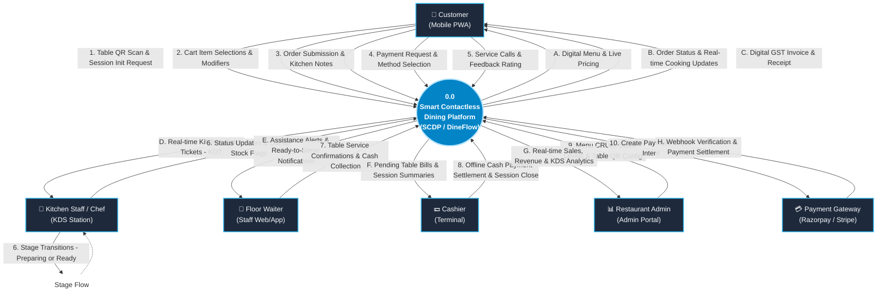
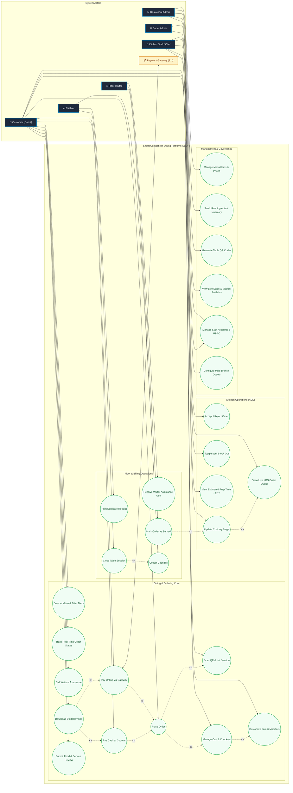
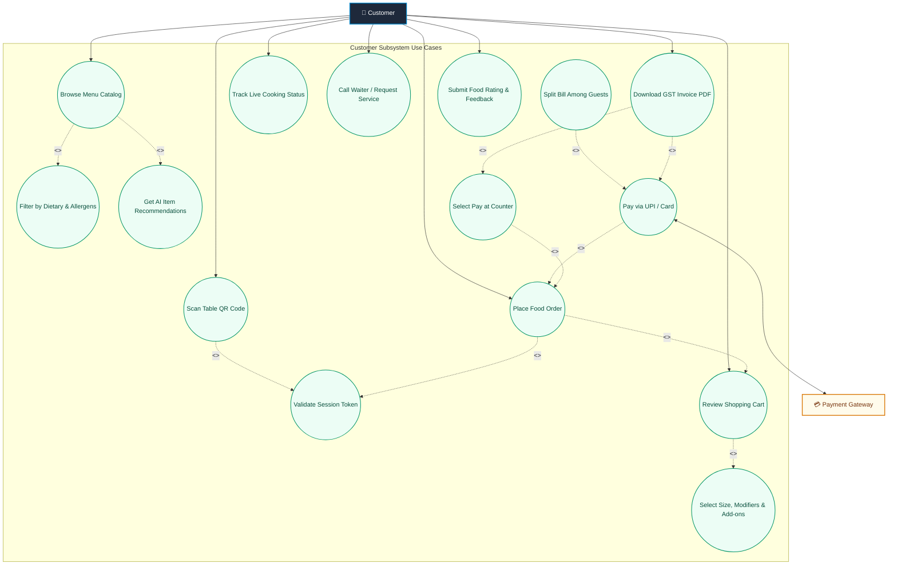
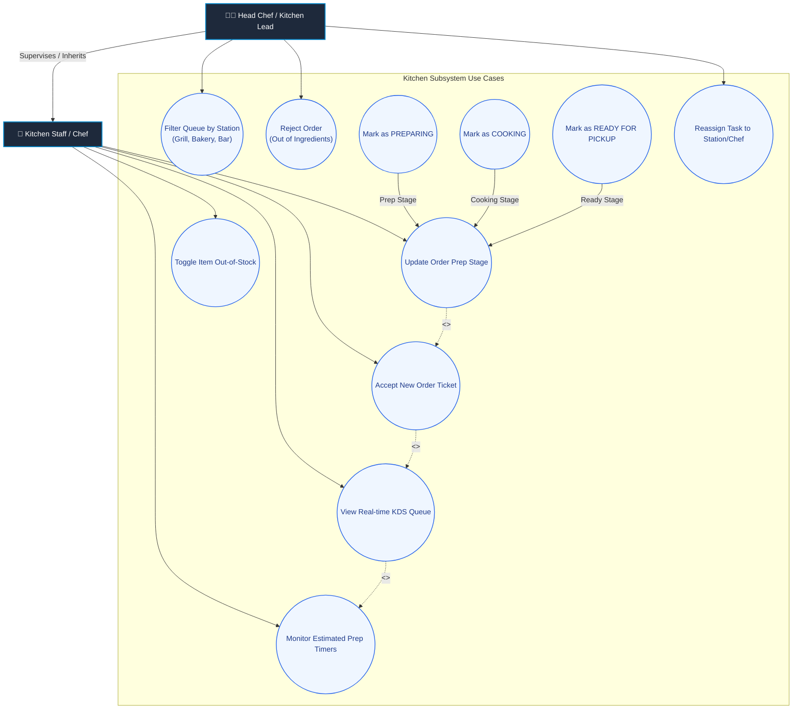
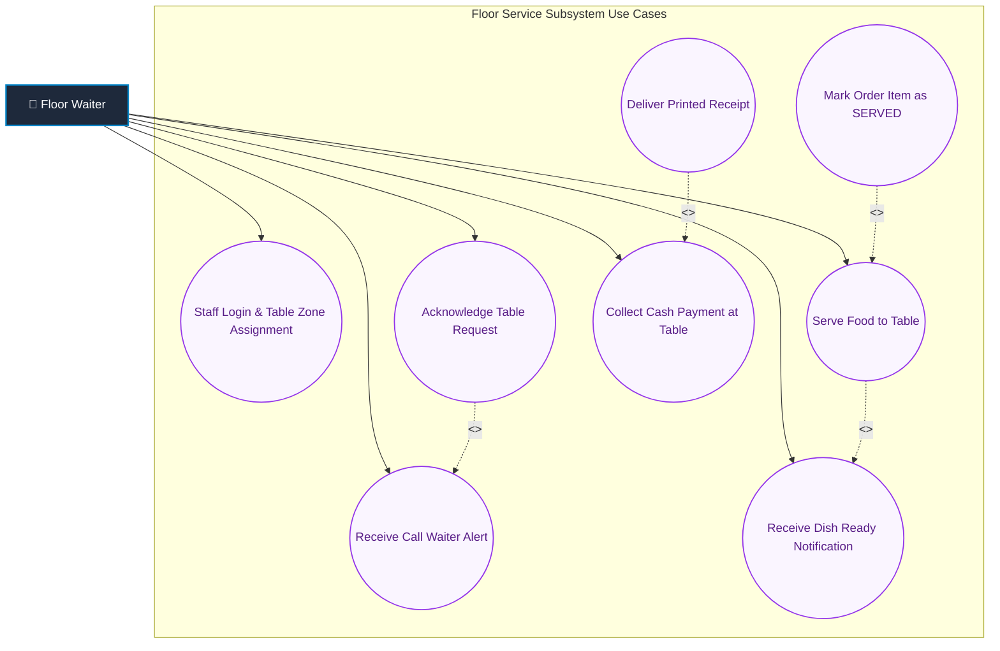
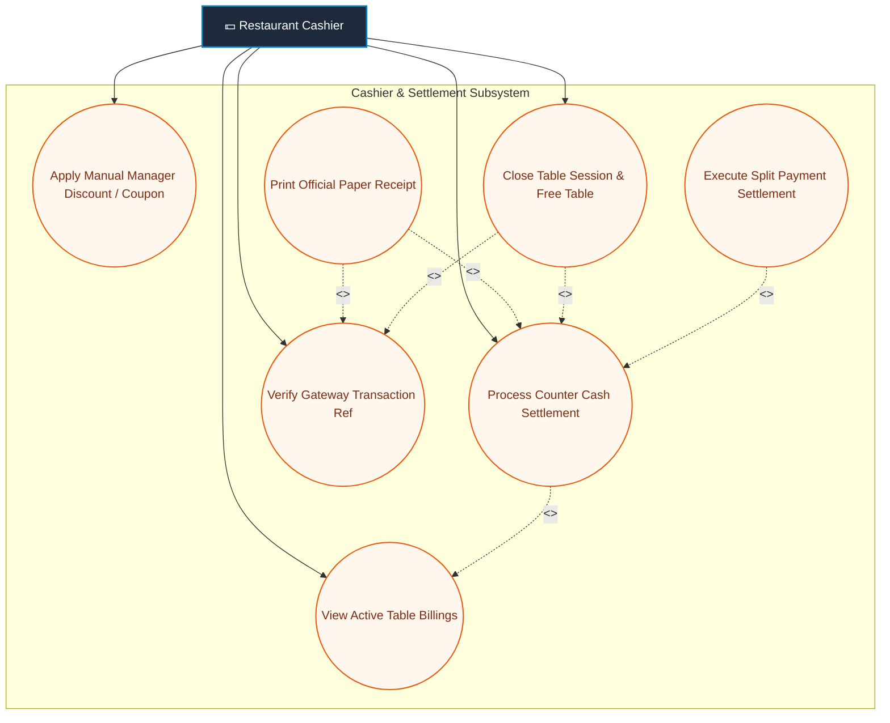
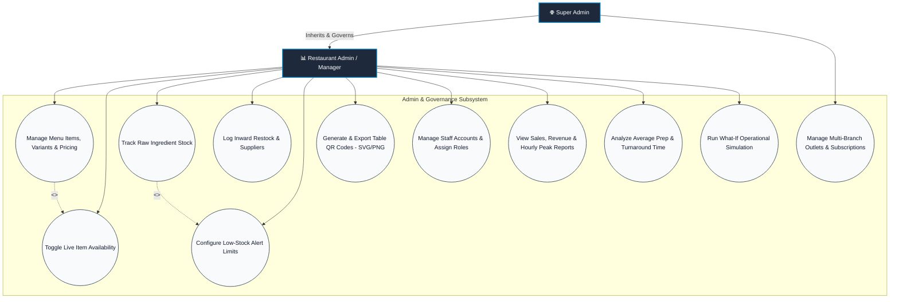

# 📊 Data Flow Diagrams (DFD) & Use Case Diagrams Specification
## Smart Contactless Dining Platform (SCDP / DineFlow)

> **Document Version**: 1.0.0  
> **Target Specification**: [project.spec.md](file:///d:/project/Sem-3-MSIT/Project/context/project.spec.md) & [project.architect.md](file:///d:/project/Sem-3-MSIT/Project/context/project.architect.md)  
> **Status**: Comprehensive Analysis & Engineering Architecture Artifact  

---

## 📑 Table of Contents
1. [Overview & Conventions](#1-overview--conventions)
2. [Data Flow Diagrams (DFD)](#2-data-flow-diagrams-dfd)
   - [2.1 Level 0: Context Data Flow Diagram (Top-Level)](#21-level-0-context-data-flow-diagram-top-level)
   - [2.2 Level 1: Subsystem Data Flow Diagram (Middle-Level)](#22-level-1-subsystem-data-flow-diagram-middle-level)
   - [2.3 Level 2: Detailed Data Flow Diagrams (Lower-Level)](#23-level-2-detailed-data-flow-diagrams-lower-level)
     - [2.3.1 DFD 2.0 - Order Processing & Validation Subsystem](#231-dfd-20---order-processing--validation-subsystem)
     - [2.3.2 DFD 3.0 - Kitchen Routing & KDS Workflow Subsystem](#232-dfd-30---kitchen-routing--kds-workflow-subsystem)
     - [2.3.3 DFD 4.0 - Payment Processing & Digital Invoicing Subsystem](#233-dfd-40---payment-processing--digital-invoicing-subsystem)
     - [2.3.4 DFD 5.0 - Inventory Tracking & Depletion Subsystem](#234-dfd-50---inventory-tracking--depletion-subsystem)
3. [DFD Data Dictionary](#3-dfd-data-dictionary)
4. [Use Case Diagrams](#4-use-case-diagrams)
   - [4.1 Complete System-Wide Use Case Diagram](#41-complete-system-wide-use-case-diagram)
   - [4.2 Customer Self-Ordering & Dining Subsystem](#42-customer-self-ordering--dining-subsystem)
   - [4.3 Kitchen Display System (KDS) & Chef Operations](#43-kitchen-display-system-kds--chef-operations)
   - [4.4 Waitstaff & Floor Service Operations](#44-waitstaff--floor-service-operations)
   - [4.5 Cashier & Billing Settlement](#45-cashier--billing-settlement)
   - [4.6 Restaurant Management & Administrative Operations](#46-restaurant-management--administrative-operations)
5. [Key Use Case Detailed Specifications](#5-key-use-case-detailed-specifications)

---

## 1. Overview & Conventions

### 1.1 DFD Notation Elements (Yourdon / DeMarco & Gane-Sarson Standards)
- **External Entity**: Square / Rectangle with solid border `[Entity Name]`. Represents external sources or sinks of data (e.g., Customer, Chef, Payment Gateway).
- **Process**: Rounded rectangle or oval `(Process ID & Name)`. Represents transformations of data.
- **Data Store**: Open-ended rectangle or database cylinder `[(Data Store Name)]`. Represents persistent data repositories (PostgreSQL, MongoDB, Redis).
- **Data Flow**: Directed labeled arrow `-->|Data Flow|`. Shows information transfer.

### 1.2 UML Use Case Conventions
- **Actors**: Stick figures or labeled entities representing human or external system roles.
- **Use Cases**: Ovals/Nodes describing functional goals.
- **`<<include>>`**: Mandatory sub-step or required dependency.
- **`<<extend>>`**: Optional extension triggered under conditional business rules.
- **System Boundary**: Outlines the perimeter of the software system.

---

## 2. Data Flow Diagrams (DFD)

### 2.1 Level 0: Context Data Flow Diagram (Top-Level)

> 🖼️ **Rendered Diagram Image**: [View PNG](file:///d:/project/Sem-3-MSIT/Project/context/diagrams/images/dfd_level_0_context.png) | [View SVG](file:///d:/project/Sem-3-MSIT/Project/context/diagrams/images/dfd_level_0_context.svg)


The Level 0 Context Diagram abstracts the entire **Smart Contactless Dining Platform (SCDP / DineFlow)** as a single overarching system process `(0.0)`, highlighting external entities and primary data boundaries.



---

### 2.2 Level 1: Subsystem Data Flow Diagram (Middle-Level)

> 🖼️ **Rendered Diagram Image**: [View PNG](file:///d:/project/Sem-3-MSIT/Project/context/diagrams/images/dfd_level_1_subsystem.png) | [View SVG](file:///d:/project/Sem-3-MSIT/Project/context/diagrams/images/dfd_level_1_subsystem.svg)


The Level 1 DFD decomposes the system into **7 core business processes**, showing major data stores and inter-process data exchanges.

```mermaid
flowchart TB
    %% External Entities
    subgraph Entities ["External Entities"]
        CUST["👤 Customer"]
        CHEF["🍳 Kitchen Chef"]
        WAITER["🚶 Waiter"]
        CASHIER["💵 Cashier"]
        ADMIN["📊 Restaurant Admin"]
        GATEWAY["💳 Payment Gateway"]
    end

    %% Data Stores
    subgraph DataStores ["Data Stores (Polyglot Persistence Layer)"]
        DS_AUTH[("D1: Auth & Table Session Store<br/>[PostgreSQL & Redis]")]
        DS_MENU[("D2: Menu & Modifiers Catalog<br/>[MongoDB]")]
        DS_ORDERS[("D3: Orders & OrderItems Store<br/>[PostgreSQL]")]
        DS_PAYMENT[("D4: Payments & Invoices Store<br/>[PostgreSQL]")]
        DS_INVENTORY[("D5: Inventory & Raw Stock Store<br/>[PostgreSQL]")]
        DS_EVENTS[("D6: Live Event Broker / Pub-Sub<br/>[Redis Pub/Sub]")]
    end

    %% Core Level 1 Processes
    subgraph Processes ["Level 1 Core Processes"]
        P1("1.0<br/>Session & Table Authentication")
        P2("2.0<br/>Menu Catalog & Dietary Browsing")
        P3("3.0<br/>Cart & Order Placement")
        P4("4.0<br/>Kitchen Queue & KDS Routing")
        P5("5.0<br/>Payment Processing & Invoicing")
        P6("6.0<br/>Service Assistance & Waiter Call")
        P7("7.0<br/>Admin Management & Inventory Control")
    end

    %% Process 1.0 Flows
    CUST -->|Table QR Payload| P1
    P1 <-->|Validate & Cache Active Session Token| DS_AUTH
    P1 -->|Active Session Context| P2
    P1 -->|Validated Session ID| P3

    %% Process 2.0 Flows
    DS_MENU -->|Active Categories, Items & Modifiers| P2
    P2 -->|Interactive Digital Menu| CUST
    P7 -->|Menu Item Updates & Stock Status| DS_MENU

    %% Process 3.0 Flows
    CUST -->|Selected Items, Modifiers & Notes| P3
    P3 -->|Validate Prices & Dietary Tags| DS_MENU
    P3 -->|Write New Order Record| DS_ORDERS
    P3 -->|Reserve Ingredients| DS_INVENTORY
    P3 -->|Emit Order Created Event| DS_EVENTS
    P3 -->|Order Summary & Bill Amount| P5

    %% Process 4.0 Flows
    DS_EVENTS -->|Listen New Order Event| P4
    P4 <-->|Fetch/Update Order Status| DS_ORDERS
    P4 -->|Push Digital KOT to Station| CHEF
    CHEF -->|Update Prep State (Cooking/Ready)| P4
    P4 -->|Publish Prep Progress Update| DS_EVENTS
    DS_EVENTS -->|Stream Live Progress Update| CUST
    P4 -->|Dish Ready Notification| P6

    %% Process 5.0 Flows
    CUST -->|Initiate Checkout| P5
    P5 <-->|Create Transaction & Verify Signature| GATEWAY
    CASHIER -->|Record Cash Settlement| P5
    P5 -->|Record Completed Transaction| DS_PAYMENT
    P5 -->|Update Order Payment Status (PAID)| DS_ORDERS
    P5 -->|Release Table Session| DS_AUTH
    P5 -->|Itemized Digital Invoice| CUST

    %% Process 6.0 Flows
    CUST -->|Assistance Request (Water/Bill)| P6
    P6 -->|Publish Table Service Alert| DS_EVENTS
    DS_EVENTS -->|Deliver Notification Badge| WAITER
    WAITER -->|Acknowledge Service & Served Status| P6
    P6 -->|Update Order Status to SERVED| DS_ORDERS

    %% Process 7.0 Flows
    ADMIN -->|Stock Adjustments & Low Thresholds| P7
    P7 <-->|Ingredient Depletion & Restock Data| DS_INVENTORY
    DS_ORDERS -->|Sales & Fulfillment Reports| P7
    DS_PAYMENT -->|Financial Logs| P7
    P7 -->|Analytical Dashboard Metrics| ADMIN

    %% Styling
    classDef pStyle fill:#0369a1,stroke:#38bdf8,stroke-width:2px,color:#ffffff,font-weight:600;
    classDef dsStyle fill:#0f172a,stroke:#34d399,stroke-width:2px,color:#6ee7b7,font-family:monospace;
    classDef entStyle fill:#1e293b,stroke:#f59e0b,stroke-width:2px,color:#ffffff;

    class P1,P2,P3,P4,P5,P6,P7 pStyle;
    class DS_AUTH,DS_MENU,DS_ORDERS,DS_PAYMENT,DS_INVENTORY,DS_EVENTS dsStyle;
    class CUST,CHEF,WAITER,CASHIER,ADMIN,GATEWAY entStyle;
```

---

### 2.3 Level 2: Detailed Data Flow Diagrams (Lower-Level)

#### 2.3.1 DFD 2.0 - Order Processing & Validation Subsystem

> 🖼️ **Rendered Diagram Image**: [View PNG](file:///d:/project/Sem-3-MSIT/Project/context/diagrams/images/dfd_level_2_order_placement.png) | [View SVG](file:///d:/project/Sem-3-MSIT/Project/context/diagrams/images/dfd_level_2_order_placement.svg)


Decomposing **Process 3.0 (Cart & Order Placement)** into detailed atomic steps.

```mermaid
flowchart TD
    %% Entities & Stores
    CUST["👤 Customer App"]
    DS_AUTH[("D1: Table Session Store")]
    DS_MENU[("D2: Menu Catalog")]
    DS_ORDERS[("D3: Orders Store")]
    DS_INVENTORY[("D5: Inventory Store")]
    DS_EVENTS[("D6: Redis Pub/Sub")]

    %% Process Decomposition
    P31("3.1<br/>Validate Session & Cart Items")
    P32("3.2<br/>Verify Stock & Ingredient Availability")
    P33("3.3<br/>Calculate Subtotal, Tax & Discounts")
    P34("3.4<br/>Persist Order & OrderItems")
    P35("3.5<br/>Deduct Raw Ingredients")
    P36("3.6<br/>Dispatch Order Event to Message Broker")

    %% Data Flow
    CUST -->|Order Payload (TableID, Items, Modifiers)| P31
    P31 -->|Verify Table Session Token| DS_AUTH
    DS_AUTH -->|Token Validated| P31
    P31 -->|Verify Item IDs & Price Integrity| DS_MENU
    DS_MENU -->|Item Details Confirmed| P31
    P31 -->|Validated Cart| P32

    P32 -->|Check Real-time Stock Levels| DS_INVENTORY
    DS_INVENTORY -->|Stock Available| P32
    P32 -->|In-Stock Item List| P33
    P32 -.->|"Reject: Out of Stock Error"| CUST

    P33 -->|Pricing Breakdown: Subtotal + GST - Discount| P34
    P34 -->|"Write Records: Order (PENDING)"| DS_ORDERS
    P34 -->|Order Confirmation & ID| P35
    P34 -->|Return Order ID & Final Bill to Client| CUST

    P35 -->|Decrement Stock Quantities| DS_INVENTORY
    P35 -->|Completed Order Object| P36

    P36 -->|Publish Topic: /topic/kitchen/new-orders| DS_EVENTS

    %% Styling
    classDef proc fill:#0284c7,stroke:#e0f2fe,stroke-width:2px,color:#ffffff;
    classDef store fill:#0f172a,stroke:#10b981,stroke-width:2px,color:#6ee7b7;
    classDef ent fill:#1e293b,stroke:#f59e0b,stroke-width:2px,color:#ffffff;
    class P31,P32,P33,P34,P35,P36 proc;
    class DS_AUTH,DS_MENU,DS_ORDERS,DS_INVENTORY,DS_EVENTS store;
    class CUST ent;
```

---

#### 2.3.2 DFD 3.0 - Kitchen Routing & KDS Workflow Subsystem

> 🖼️ **Rendered Diagram Image**: [View PNG](file:///d:/project/Sem-3-MSIT/Project/context/diagrams/images/dfd_level_2_kitchen_kds.png) | [View SVG](file:///d:/project/Sem-3-MSIT/Project/context/diagrams/images/dfd_level_2_kitchen_kds.svg)


Decomposing **Process 4.0 (Kitchen Queue & KDS Routing)** with skill-based chef assignment and stage management.

```mermaid
flowchart TD
    %% Entities & Stores
    CHEF["🍳 Kitchen Chef Station"]
    DS_ORDERS[("D3: Orders Store")]
    DS_EVENTS[("D6: Redis Pub/Sub")]
    DS_STAFF[("D1: Staff Workload Store")]

    %% Detailed Sub-processes
    P41("4.1<br/>Consume Order Event & Parse KOT")
    P42("4.2<br/>Skill-Aware Station & Chef Routing")
    P43("4.3<br/>Display KDS Card with Dynamic EPT")
    P44("4.4<br/>Process Chef Stage Transition")
    P45("4.5<br/>Broadcast Real-time Status Event")

    %% Data Flow
    DS_EVENTS -->|Receive: New Order Event| P41
    P41 -->|Item Category, Cooking Priority & Notes| P42

    P42 -->|Query Chef Stations & Workload| DS_STAFF
    DS_STAFF -->|Available Chef Selected| P42
    P42 -->|Assigned Station KOT Ticket| P43

    P43 -->|Render Color-Coded KOT on Screen| CHEF
    CHEF -->|Action: Accept Order| P44
    CHEF -->|Action: Stage Transition (PREPARING -> COOKING -> READY)| P44

    P44 -->|Update Status & Timestamps| DS_ORDERS
    P44 -->|Stage Change Payload| P45

    P45 -->|Publish: /topic/table/tableId/order-updates| DS_EVENTS
    P45 -->|When READY: Publish /topic/waiter/alerts| DS_EVENTS

    %% Styling
    classDef proc fill:#0284c7,stroke:#e0f2fe,stroke-width:2px,color:#ffffff;
    classDef store fill:#0f172a,stroke:#10b981,stroke-width:2px,color:#6ee7b7;
    classDef ent fill:#1e293b,stroke:#f59e0b,stroke-width:2px,color:#ffffff;
    class P41,P42,P43,P44,P45 proc;
    class DS_ORDERS,DS_EVENTS,DS_STAFF store;
    class CHEF ent;
```

---

#### 2.3.3 DFD 4.0 - Payment Processing & Digital Invoicing Subsystem

> 🖼️ **Rendered Diagram Image**: [View PNG](file:///d:/project/Sem-3-MSIT/Project/context/diagrams/images/dfd_level_2_payment_invoicing.png) | [View SVG](file:///d:/project/Sem-3-MSIT/Project/context/diagrams/images/dfd_level_2_payment_invoicing.svg)


Decomposing **Process 5.0 (Payment Processing & Invoicing)** for online and counter settlements.

```mermaid
flowchart TD
    %% Entities & Stores
    CUST["👤 Customer"]
    CASHIER["💵 Cashier"]
    GATEWAY["💳 Payment Gateway (Razorpay/Stripe)"]
    DS_ORDERS[("D3: Orders Store")]
    DS_PAYMENT[("D4: Payments & Invoices Store")]
    DS_AUTH[("D1: Session Store")]
    DS_EVENTS[("D6: Redis Pub/Sub")]

    %% Processes
    P51("5.1<br/>Select Payment Channel")
    P52("5.2<br/>Create Gateway Order & Signature Token")
    P53("5.3<br/>Verify Webhook / Cryptographic Signature")
    P54("5.4<br/>Process Counter Cash Receipt")
    P55("5.5<br/>Update Order Status & Settle Ledger")
    P56("5.6<br/>Generate Itemized GST PDF Invoice")
    P57("5.7<br/>Release Table Session & Close Order")

    %% Flows
    CUST -->|Checkout Choice: Online or Cash| P51

    %% Online branch
    P51 -->|Online Payment Selected| P52
    P52 <-->|Create Payment Intent| GATEWAY
    P52 -->|Gateway Order Credentials| CUST
    CUST -->|Complete UPI / Card Payment| GATEWAY
    GATEWAY -->|Webhook Notification & Signature| P53
    P53 -->|Validated Online Transaction| P55

    %% Cash branch
    P51 -->|Pay at Counter Selected| P54
    CASHIER -->|Confirm Cash Received & Authenticate| P54
    P54 -->|Cash Transaction Record| P55

    %% Persistence & Invoicing
    P55 -->|Write Payment Record (Method, TxnID, Status: PAID)| DS_PAYMENT
    P55 -->|Update Order Payment State to PAID| DS_ORDERS
    P55 -->|Trigger Invoice Generation| P56

    P56 -->|Generate GST Compliant Digital Receipt| DS_PAYMENT
    P56 -->|Deliver PDF Invoice URL / WhatsApp Link| CUST
    P56 -->|Trigger Session Release| P57

    P57 -->|Mark Session COMPLETED / Reset Table| DS_AUTH
    P57 -->|Publish Table Reset Event| DS_EVENTS

    %% Styling
    classDef proc fill:#0284c7,stroke:#e0f2fe,stroke-width:2px,color:#ffffff;
    classDef store fill:#0f172a,stroke:#10b981,stroke-width:2px,color:#6ee7b7;
    classDef ent fill:#1e293b,stroke:#f59e0b,stroke-width:2px,color:#ffffff;
    class P51,P52,P53,P54,P55,P56,P57 proc;
    class DS_ORDERS,DS_PAYMENT,DS_AUTH,DS_EVENTS store;
    class CUST,CASHIER,GATEWAY ent;
```

---

#### 2.3.4 DFD 5.0 - Inventory Tracking & Depletion Subsystem

> 🖼️ **Rendered Diagram Image**: [View PNG](file:///d:/project/Sem-3-MSIT/Project/context/diagrams/images/dfd_level_2_inventory_tracking.png) | [View SVG](file:///d:/project/Sem-3-MSIT/Project/context/diagrams/images/dfd_level_2_inventory_tracking.svg)


Decomposing **Process 7.0 Inventory Sub-processes** showing recipe tracking, ingredient depletion, and automated threshold alerts.

```mermaid
flowchart TD
    %% Entities & Stores
    ADMIN["📊 Restaurant Admin"]
    DS_ORDERS[("D3: Orders Store")]
    DS_RECIPE[("D2: Recipe & BOM Store")]
    DS_INVENTORY[("D5: Inventory & Raw Stock Store")]
    NOTIFICATION["🔔 Admin Notification System"]

    %% Processes
    P71("7.1<br/>Map Order Items to Recipe Ingredients")
    P72("7.2<br/>Calculate Raw Material Consumption")
    P73("7.3<br/>Update Stock Balance in Real-Time")
    P74("7.4<br/>Evaluate Low-Stock Thresholds")
    P75("7.5<br/>Trigger Restock Alert & Auto-Disable Item")

    %% Flows
    DS_ORDERS -->|Completed/In-Prep Order Items| P71
    P71 <-->|Fetch Recipe Bill of Materials (BOM)| DS_RECIPE
    P71 -->|Ingredient Units Required| P72

    P72 -->|Computed Deductions (e.g., -200g Cheese)| P73
    P73 <-->|Update Stock Balance| DS_INVENTORY
    P73 -->|New Current Stock Levels| P74

    P74 -->|Compare Against Minimum Safety Stock| P74
    P74 -->|Threshold Breached: Stock <= MinStock| P75
    P74 -->|Stock Adequate| DS_INVENTORY

    P75 -->|Dispatch Critical Low-Stock Warning| NOTIFICATION
    NOTIFICATION -->|Push Alert & Email Summary| ADMIN
    P75 -->|Set Item is_available = FALSE| DS_RECIPE
    ADMIN -->|Restock Order & Record Inflow| DS_INVENTORY

    %% Styling
    classDef proc fill:#0284c7,stroke:#e0f2fe,stroke-width:2px,color:#ffffff;
    classDef store fill:#0f172a,stroke:#10b981,stroke-width:2px,color:#6ee7b7;
    classDef ent fill:#1e293b,stroke:#f59e0b,stroke-width:2px,color:#ffffff;
    class P71,P72,P73,P74,P75 proc;
    class DS_ORDERS,DS_RECIPE,DS_INVENTORY store;
    class ADMIN,NOTIFICATION ent;
```

---

## 3. DFD Data Dictionary

| Data Flow / Element | Source | Destination | Data Composition & Types |
| :--- | :--- | :--- | :--- |
| `Table_QR_Scan_Payload` | Customer Mobile | Process 1.0 (Auth) | `{ tableId: UUID, token: String, timestamp: DateTime }` |
| `Session_Context` | Process 1.0 | Data Store D1 | `{ sessionId: UUID, tableNumber: Integer, status: Enum("ACTIVE","COMPLETED"), jwtToken: String }` |
| `Menu_Catalog_Response` | Data Store D2 | Customer Mobile | `{ categories: Array<{ id: UUID, name: String, items: Array<MenuItem> }> }` |
| `Order_Submission_Payload`| Customer Mobile | Process 3.0 | `{ sessionId: UUID, items: Array<{ itemId: UUID, variantId: UUID, modifiers: Array<UUID>, qty: Int, notes: String }> }` |
| `Kitchen_Order_Ticket (KOT)`| Process 4.0 | Kitchen Display | `{ orderId: UUID, orderNum: String, tableNum: Int, items: Array<ItemSummary>, eptMinutes: Int, status: Enum }` |
| `Status_Update_Event` | Chef Station | Redis Pub/Sub | `{ orderId: UUID, newStatus: Enum("PREPARING","COOKING","READY","SERVED"), updatedBy: UUID }` |
| `Payment_Intent_Payload`| Process 5.0 | Payment Gateway | `{ orderId: UUID, amount: Decimal, currency: "INR", customerPhone: String, customerEmail: String }` |
| `Digital_Invoice_Data` | Process 5.0 | Data Store D4 | `{ invoiceId: UUID, gstNumber: String, subtotal: Decimal, cgst: Decimal, sgst: Decimal, total: Decimal, pdfUrl: String }` |
| `Assistance_Alert` | Customer Mobile | Waiter Mobile | `{ tableId: UUID, tableNum: Int, requestType: Enum("WATER","CUTLERY","BILL","STAFF"), timestamp: DateTime }` |
| `Low_Stock_Alert` | Process 7.0 | Admin Dashboard | `{ ingredientId: UUID, name: String, currentQty: Float, thresholdQty: Float, unit: String }` |

---

## 4. Use Case Diagrams

### 4.1 Complete System-Wide Use Case Diagram

> 🖼️ **Rendered Diagram Image**: [View PNG](file:///d:/project/Sem-3-MSIT/Project/context/diagrams/images/usecase_complete_system.png) | [View SVG](file:///d:/project/Sem-3-MSIT/Project/context/diagrams/images/usecase_complete_system.svg)


This comprehensive diagram maps all primary actors (`Customer`, `Kitchen Chef`, `Floor Waiter`, `Cashier`, `Restaurant Admin`, and `Super Admin`), alongside the external `Payment Gateway`, across the complete DineFlow ecosystem.



---

### 4.2 Customer Self-Ordering & Dining Subsystem

> 🖼️ **Rendered Diagram Image**: [View PNG](file:///d:/project/Sem-3-MSIT/Project/context/diagrams/images/usecase_customer_subsystem.png) | [View SVG](file:///d:/project/Sem-3-MSIT/Project/context/diagrams/images/usecase_customer_subsystem.svg)


Detailed decomposition of customer-facing use cases with standard UML `<<include>>` and `<<extend>>` dependencies.



---

### 4.3 Kitchen Display System (KDS) & Chef Operations

> 🖼️ **Rendered Diagram Image**: [View PNG](file:///d:/project/Sem-3-MSIT/Project/context/diagrams/images/usecase_kitchen_subsystem.png) | [View SVG](file:///d:/project/Sem-3-MSIT/Project/context/diagrams/images/usecase_kitchen_subsystem.svg)


Detailed use case mapping for kitchen personnel, prep stations, and real-time state management.



---

### 4.4 Waitstaff & Floor Service Operations

> 🖼️ **Rendered Diagram Image**: [View PNG](file:///d:/project/Sem-3-MSIT/Project/context/diagrams/images/usecase_waitstaff_floor.png) | [View SVG](file:///d:/project/Sem-3-MSIT/Project/context/diagrams/images/usecase_waitstaff_floor.svg)


Use case model for waitstaff floor monitoring, table delivery, and customer call resolution.



---

### 4.5 Cashier & Billing Settlement

> 🖼️ **Rendered Diagram Image**: [View PNG](file:///d:/project/Sem-3-MSIT/Project/context/diagrams/images/usecase_cashier_settlement.png) | [View SVG](file:///d:/project/Sem-3-MSIT/Project/context/diagrams/images/usecase_cashier_settlement.svg)


Use cases for point-of-sale cashier operators managing bills, manual payments, and table turnover.



---

### 4.6 Restaurant Management & Administrative Operations

> 🖼️ **Rendered Diagram Image**: [View PNG](file:///d:/project/Sem-3-MSIT/Project/context/diagrams/images/usecase_admin_governance.png) | [View SVG](file:///d:/project/Sem-3-MSIT/Project/context/diagrams/images/usecase_admin_governance.svg)


Administrative capabilities for store managers and enterprise operators.



---

## 5. Key Use Case Detailed Specifications

### Use Case UC-01: Submit Food Order & Checkout
| Attribute | Detail |
| :--- | :--- |
| **Use Case ID** | `UC-01` |
| **Use Case Name** | Submit Food Order & Checkout |
| **Primary Actor** | Customer (Guest) |
| **Secondary Actor(s)**| Kitchen Staff, Payment Gateway |
| **Preconditions** | Customer has scanned a valid Table QR code and initialized an active session; items are present in cart. |
| **Trigger** | Customer clicks the **"Confirm & Place Order"** button. |
| **Main Success Scenario (Happy Path)** | 1. Customer reviews cart items, customization modifiers, and dietary notes.<br/>2. Customer chooses payment option (Online UPI/Card or Pay at Counter).<br/>3. System validates table session lock and ensures items are in stock.<br/>4. If Online Payment is chosen: System creates Razorpay order intent; Customer completes payment; Razorpay returns verified signature.<br/>5. System creates order record in database with status `PENDING_KITCHEN`.<br/>6. System decrements ingredient stocks in inventory.<br/>7. System publishes real-time WebSocket event to kitchen queue `/topic/kitchen/new-orders`.<br/>8. Customer UI updates to live order tracking screen displaying order number and initial EPT timer. |
| **Alternative Flows** | **A1: Item Out of Stock During Checkout**: System flags the depleted item, alerts the user, and prompts to remove or substitute the item.<br/>**A2: Payment Failed/Timeout**: System marks transaction as failed, preserves cart, and allows retry or switch to "Pay at Counter".<br/>**A3: Pay at Counter Chosen**: System bypasses online gateway, sets payment status to `PENDING`, and dispatches order directly to kitchen queue. |
| **Postconditions** | Order is persisted in PostgreSQL; active order appears on KDS screen; customer screen tracks preparation status. |

---

### Use Case UC-02: Manage Kitchen Display & Update Order Stages
| Attribute | Detail |
| :--- | :--- |
| **Use Case ID** | `UC-02` |
| **Use Case Name** | Manage Kitchen Display & Update Order Stages |
| **Primary Actor** | Kitchen Staff / Chef |
| **Secondary Actor(s)**| Floor Waiter, Customer |
| **Preconditions** | Chef is logged in to the KDS web terminal assigned to a kitchen prep station. |
| **Trigger** | New order ticket arrives on KDS screen via WebSocket connection. |
| **Main Success Scenario (Happy Path)** | 1. KDS plays audio chime and displays high-priority color-coded order card.<br/>2. Chef clicks **"Accept"**; order status transitions to `ACCEPTED`.<br/>3. Chef starts cooking and clicks **"Start Preparing"**; status transitions to `PREPARING`.<br/>4. Food is prepared, plated, and chef clicks **"Mark Ready"**; status transitions to `READY`.<br/>5. System updates database order state and publishes WebSocket event to `/topic/table/{tableId}/order-updates` and `/topic/waiter/alerts`.<br/>6. Customer screen immediately updates to "Food is Ready! On its way to your table".<br/>7. Waiter device receives pickup alert with table number. |
| **Alternative Flows** | **A1: Kitchen Rejects Order**: If chef notices critical ingredient shortage, clicks "Reject Order" with reason; system cancels order, triggers automatic refund if paid online, and notifies customer and manager. |
| **Postconditions** | Order progresses to ready state; waitstaff notified for pickup; customer real-time tracking updated. |

---

### Use Case UC-03: Settle Bill & Close Table Session
| Attribute | Detail |
| :--- | :--- |
| **Use Case ID** | `UC-03` |
| **Use Case Name** | Settle Bill & Close Table Session |
| **Primary Actor** | Cashier / Floor Waiter |
| **Secondary Actor(s)**| Customer |
| **Preconditions** | All orders for the table session are marked as `SERVED`. |
| **Trigger** | Customer requests bill settlement via app, or cashier inspects table bill at counter. |
| **Main Success Scenario (Happy Path)** | 1. Cashier selects table number on POS terminal to review consolidated order history.<br/>2. If customer paid online: Cashier verifies `PAID` badge and generates final receipt.<br/>3. If customer pays cash: Cashier inputs cash received, system calculates change, and cashier confirms settlement.<br/>4. System records payment transaction with timestamp and cashier ID.<br/>5. System issues GST-compliant PDF invoice link sent via SMS/WhatsApp or printed.<br/>6. Cashier clicks **"Release Table / Close Session"**.<br/>7. Table status reverts to `AVAILABLE` in PostgreSQL; active session token expires in Redis.<br/>8. Customer app displays "Thank you for dining with us! Please leave a review." |
| **Alternative Flows** | **A1: Split Bill Requested**: System divides order items or total amount across separate guest payments and closes session once the balance hits zero. |
| **Postconditions** | Order status marked `COMPLETED`; table session terminated; table ready for new guests. |

---

## 6. Summary Matrix

| Diagram Category | Level | Primary Target Audience | Architectural Focus |
| :--- | :--- | :--- | :--- |
| **DFD Level 0** | Context (Top) | Stakeholders, Project Managers | System boundaries, external actors, high-level data flows. |
| **DFD Level 1** | Subsystems (Mid) | Solution Architects, Lead Engineers | Decomposition into 7 core processes, polyglot databases, event broker. |
| **DFD Level 2** | Micro-Processes (Low)| Backend Developers, API Engineers | Atomic steps in Ordering, KDS, Invoicing, and Inventory depletion. |
| **Use Case System** | High-Level | Product Managers, QA Engineers | Global actor responsibilities and cross-cutting dependencies. |
| **Use Case Subsystems**| Domain-Specific | Frontend & Backend Feature Teams | Detailed user stories, preconditions, happy paths, and error alternatives. |
