# DineFlow — Subscription, Entitlement & Role-Specific Dashboard Implementation Plan

> **Purpose:** Implement subscription-based feature access, restaurant lifecycle management, role-specific dashboards, and effective authorization in the existing DineFlow platform.
>
> **Status:** Implementation blueprint  
> **Planning estimate:** 6 phases / approximately 6 weeks  
> **Important:** This plan extends the existing DineFlow architecture. It does not replace the current QR/table-session, menu, order, payment, kitchen, authentication, or RBAC flows.

---

## 1. Implementation principles

1. Keep the existing Spring Boot Auth Service as the identity and staff-authentication authority.
2. Keep PostgreSQL as the source of truth for restaurants, plans, subscriptions, entitlements, memberships, roles, privileges, and audit records.
3. Extend the existing `roles`, `privileges`, and `role_privileges` model. Do not create a second RBAC system.
4. Enforce authorization in backend services and APIs. Frontend navigation visibility is not a security boundary.
5. A feature is usable only when **both** the subscription entitlement and the user's role permission allow it.
6. Resolve restaurant identity from authenticated server-side context. Do not trust a client-supplied `restaurantId` for authorization.
7. Use Redis for invalidation/pub-sub only; the current effective-access implementation deliberately does not cache authorization decisions.
8. Keep `CUSTOMER_GUEST` in the existing QR/table-session customer journey. It is not a staff dashboard role.
9. Deliver the work in small, testable increments. Do not start a dependent phase until its completion gate passes.

## 2. High-level delivery flow

```mermaid
flowchart TD
    A["Phase 0 — Discovery & architecture baseline"] --> B{"Baseline approved?"}
    B -- No --> A
    B -- Yes --> C["Phase 1 — Database & platform foundation"]
    C --> D{"Schema and migration tests pass?"}
    D -- No --> C
    D -- Yes --> E["Phase 2 — Restaurant registration & Super Admin"]
    E --> F{"Restaurant lifecycle tests pass?"}
    F -- No --> E
    F -- Yes --> G["Phase 3 — Plans, subscriptions & overrides"]
    G --> H{"Subscription lifecycle tests pass?"}
    H -- No --> G
    H -- Yes --> I["Phase 4 — Effective access & authorization"]
    I --> J{"Backend authorization tests pass?"}
    J -- No --> I
    J -- Yes --> K["Phase 5 — Role-specific dashboards"]
    K --> L{"Role UI and route tests pass?"}
    L -- No --> K
    L -- Yes --> M["Phase 6 — Integration, hardening & release"]
    M --> N{"Release checklist passes?"}
    N -- No --> M
    N -- Yes --> O["Feature complete"]
```



---

## 3. Phase-by-phase implementation checklist

### Phase 0 — Discovery and architecture baseline

**Status: DONE** — repository baseline and provisional schema decisions are recorded; policy defaults still require product-owner confirmation before Phase 2/3 behavior is released.

**Goal:** Confirm existing implementation details and resolve decisions that affect the schema and authorization model.

#### Tasks

- [x] Inspect the current repository structure and identify the Auth Service, API gateway, restaurant services, frontend applications, database migration setup, and test conventions.
- [x] Review the existing `users`, `roles`, `privileges`, and `role_privileges` entities and staff JWT identity/role/privilege claims.
- [x] Confirm that the Auth Service has no restaurant registration/entity model yet; current restaurant identity is carried as `users.restaurant_id`.
- [x] Confirm that the first release keeps one restaurant per staff user; no multi-membership table is introduced.
- [x] Decide that `SUPER_ADMIN` uses the existing role and may have a null restaurant ID; the current JPA field is nullable despite older documentation describing it as required.
- [x] Set provisional subscription lifecycle defaults for schema design; confirm them with the product owner before implementing lifecycle behavior:
  - [x] 14-day trial, eligible once per restaurant; trial timestamps are stored explicitly.
  - [x] `PAST_DUE` remains entitled through an explicit 7-day grace period.
  - [x] Cancellation is effective at the current paid-through period end.
  - [x] Expiry removes subscription-dependent restaurant access without deleting business or audit data.
  - [x] Suspension blocks restaurant operations; only Super Admin platform review/reactivation remains available.
- [x] Define that registration submission creates a pending review; only `SUPER_ADMIN` may approve, reject, suspend, or reactivate a restaurant.
- [x] Select stable feature keys for current menu, order, table/QR, kitchen, waiter, cashier, and revenue-analytics capabilities; proposed AI features remain unseeded until implemented.
- [x] Define administrative audit records as retained online for at least 24 months, then archived subject to applicable retention/legal-hold policy.
- [x] Record these baseline decisions and the remaining plan-matrix dependency below.

**Deliverables**

- Recorded architecture decision baseline.
- Repository/service ownership map.
- Initial feature catalogue.
- Migration and test strategy.

**Completion gate**

- [x] All Phase 1 schema-affecting decisions are recorded.
- [x] Existing authentication and customer QR-session flows are documented in the supplied architecture and feature specification.
- [x] No unresolved decision blocks Phase 1; commercial plan-to-feature matrices remain deliberately deferred to Phase 3.

#### Provisional decision baseline for implementation

- Staff accounts retain the existing single `restaurant_id` context. Platform Super Admin accounts use the existing `SUPER_ADMIN` role with no restaurant assignment; no parallel account or RBAC model is added.
- Trial eligibility is one 14-day trial per restaurant. `PAST_DUE` access may continue through a 7-day grace period. Cancellation takes effect at the end of the current paid period; expiry and suspension do not delete data.
- An explicit, currently valid restaurant feature override takes precedence over the plan; when overlapping overrides exist, the latest `valid_from` wins, then latest creation time. An explicit disable is authoritative.
- Only Super Admin may transition registration and restaurant lifecycle states. Future commercial plan matrices/prices require separate approval and are not invented or seeded in Phase 1.
- Audit events are retained online for at least 24 months and archived thereafter subject to applicable retention and legal-hold policy.
- These are recorded implementation defaults, not stakeholder sign-off; confirm them before Phase 2/3 behavior is released to production.

---

### Phase 1 — Database and platform foundation

**Status: ~~IN_PROGRESS~~ DONE** — PostgreSQL clean-install and legacy-upgrade checks passed; existing Auth Service tests pass.

**Goal:** Establish the persistent data model without breaking existing DineFlow data or flows.

#### 1.1 Database migrations

- [x] ~~Create or extend the `restaurants` table with lifecycle status and unique restaurant identifier fields, if not already present.~~
- [x] ~~Create `restaurant_registrations` for submitted registration details and approval status.~~
- [x] ~~Create `features` with a stable unique key, name, description, and active flag.~~
- [x] ~~Create `subscription_plans`.~~
- [x] ~~Create `plan_features` to map plans to feature entitlements and optional limits.~~
- [x] ~~Create `restaurant_subscriptions` with plan, lifecycle status, start/end dates, trial dates, and billing-period metadata.~~
- [x] ~~Create `entitlement_overrides` with feature key, enable/disable value, reason, validity window, creator, and audit metadata.~~
- [x] ~~Create `subscription_events` for lifecycle transitions.~~
- [x] ~~Create or extend `audit_logs` for platform and restaurant administration actions.~~
- [x] ~~Create `authorization_versions` or an equivalent version counter for permission/entitlement cache invalidation.~~
- [x] ~~Add indexes, foreign keys, uniqueness constraints, and tenant-scoped constraints.~~
- [x] ~~Preserve and extend existing RBAC tables rather than duplicating them.~~

#### 1.2 Data and migration safety

- [x] ~~Write a versioned additive migration and document safe backup/rollback procedures.~~
- [x] ~~Seed the initial catalogue for currently implemented DineFlow capabilities; leave proposed AI capabilities inactive/unseeded.~~
- [x] ~~Defer Starter, Professional, and Enterprise plan seed rows until their feature matrices are approved in Phase 3; no unapproved entitlement matrix is invented.~~
- [x] ~~Keep Custom as an administratively configurable plan/entitlement arrangement.~~
- [x] ~~Validate the migration against a clean PostgreSQL database (seven features, zero legacy restaurants, Flyway V1 recorded).~~
- [x] ~~Validate upgrade against a disposable legacy-schema database; the existing user, RBAC link, restaurant table, table session, and order row remained intact.~~
- [x] ~~Verify existing user/role/privilege and tenant-scoped data remains intact; legacy restaurant IDs are backfilled once as active records.~~

**Deliverables**

- Versioned Flyway migration and baseline configuration; rollback/upgrade notes in `Project/auth/docs/database-migrations.md`.
- Feature catalogue seeds; plan seeds are deferred until Phase 3 matrix approval.
- JPA entity and repository models for the Phase 1 data foundation.
- PostgreSQL clean-install and legacy-upgrade validation; H2 repository and existing application tests.

**Completion gate**

- [x] Clean-install migration passes.
- [x] Existing-data upgrade test passes.
- [x] Foreign-key and tenant-isolation constraints are verified.
- [x] Existing application tests still pass.

---

### Phase 2 — Restaurant registration and Super Admin operations

**Status: IMPLEMENTED** — registration/review APIs, audits, Super Admin dashboard, and Auth-backed suspension enforcement across downstream staff APIs are implemented and tested.

**Goal:** Let the platform team approve restaurants and manage their platform-level lifecycle.

#### 2.1 Registration workflow

- [x] ~~Implement a public restaurant registration form and submission endpoint.~~
- [x] ~~Validate required registration fields and prevent duplicate pending registrations by normalized owner email or restaurant name.~~
- [x] ~~Store registrations as pending review.~~
- [x] ~~Implement pending-to-approved/rejected transitions with optimistic concurrency control.~~
- [x] ~~Record the reviewing Super Admin and review timestamp.~~

#### 2.2 Super Admin backend

- [x] ~~Implement Super Admin authorization for platform-level endpoints; reject Super Admin creation through public staff registration.~~
- [x] ~~Add paginated restaurant/registration listing with filters and bounded page sizes.~~
- [x] ~~Implement approve action.~~
- [x] ~~Generate an immutable, server-side `DF-` + UUID Restaurant ID during approval.~~
- [x] ~~Implement reject action with a required reason.~~
- [x] ~~Implement suspend and reactivate actions with required suspension reason and valid state transitions.~~
- [x] ~~Add actor-attributed audit events and a paginated audit history API for every state-changing action.~~
- [x] ~~Ensure restaurant administrators cannot call platform-level endpoints (authorization tests cover allow/deny).~~
- [x] ~~Preserve tenant isolation in restaurant-scoped Auth APIs and existing restaurant data operations.~~
- [x] ~~Block suspended restaurant staff from new login and Auth Service API requests and downstream staff Node-service operations.~~

#### 2.3 Super Admin dashboard

- [x] ~~Create a dedicated Super Admin shell and navigation.~~
- [x] ~~Display **DineFlow** as the platform identity in the header.~~
- [x] ~~Add a public restaurant application form and Super Admin registration review/management screens.~~
- [x] ~~Add restaurant status, registration status, and audit history views.~~
- [x] ~~Add loading, empty, error, and unauthorized states.~~

**Deliverables**

- Public restaurant application form and registration/review/lifecycle REST APIs.
- Dedicated Super Admin dashboard with registration queue, restaurant directory, status controls, and audit history.
- Audited approval/rejection/suspension/reactivation workflow; immediate suspension checks in the Auth Service.

**Completion gate**

- [x] Approval generates a unique Restaurant ID.
- [x] Rejected registrations cannot be treated as active restaurants.
- [x] Suspended restaurants are blocked across Auth and downstream staff service operations by online effective-access checks.
- [x] Super Admin-only endpoint tests pass.
- [x] Cross-restaurant access tests pass.

---

### Phase 3 — Plans, subscriptions, and entitlement overrides

**Status: IMPLEMENTED** — configurable catalogue, plans, snapshots, lifecycle APIs/scheduler, overrides, and Super Admin UI are implemented and tested. Policy defaults remain provisional pending product-owner approval before production release; no unapproved pricing or plan matrix is seeded.

**Goal:** Allow Super Admin to define plans and control the feature entitlements available to each restaurant.

#### 3.1 Plan management

- [x] ~~Implement feature catalogue read/create/update operations with permanent stable feature keys.~~
- [x] ~~Implement plan create/read/update operations.~~
- [x] ~~Implement plan-to-feature mapping.~~
- [x] ~~Support JSON quota/limit values for features that declare limit support.~~
- [x] ~~Validate plan changes, duplicate mappings, supported limits, and feature references.~~
- [x] ~~Snapshot plan entitlements when assigning a subscription; later plan edits do not change existing subscriptions.~~

#### 3.2 Subscription management

- [x] ~~Assign plans to restaurants and retain a complete subscription history.~~
- [x] ~~Store subscription start, billing-period, trial, grace, cancellation, and end timestamps.~~
- [x] ~~Implement the supported lifecycle transitions for `TRIALING`, `ACTIVE`, `PAST_DUE`, `CANCELLED`, `EXPIRED`, and `SUSPENDED`.~~
- [x] ~~Validate transitions and reject invalid or terminal-state changes in the service layer.~~
- [x] ~~Implement a bounded scheduled job for trial, paid-period, cancellation, and grace-period expiry.~~
- [x] ~~Make scheduled transitions safe to retry with status re-checks and optimistic versioning.~~
- [x] ~~Record subscription assignments and every lifecycle transition in `subscription_events` and `audit_logs`.~~
- [x] ~~Implement and test the provisional seven-day past-due grace period.~~

#### 3.3 Restaurant-specific overrides

- [x] ~~Allow Super Admin users to enable or disable a feature for one restaurant.~~
- [x] ~~Require a reason for each override.~~
- [x] ~~Support scheduled start and end timestamps.~~
- [x] ~~Use the latest currently valid override (latest `valid_from`, then creation time) ahead of the plan entitlement.~~
- [x] ~~Exclude not-yet-valid, expired, and revoked overrides from current override resolution.~~
- [x] ~~Audit creation, modification, and revocation of overrides.~~

#### 3.4 Super Admin subscription UI

- [x] ~~Add Super Admin feature catalogue and plan management screens.~~
- [x] ~~Add restaurant subscription assignment, lifecycle controls, and history.~~
- [x] ~~Add a plan entitlement matrix with optional limits.~~
- [x] ~~Add override management with required reason and scheduled expiry.~~
- [x] ~~Clearly separate plan entitlement matrices from restaurant-specific overrides.~~

**Deliverables**

- Super Admin-only feature/plan, subscription, lifecycle, and override APIs.
- Scheduled expiry processing with bounded batches, idempotent state checks, and optimistic locking.
- Audited override service with validity windows and deterministic precedence.
- Super Admin catalogue, plan matrix, subscription, and override screens.

**Completion gate**

- [x] ~~Plan-feature mappings and limits are validated.~~
- [x] ~~Supported lifecycle transitions and invalid transitions are covered by tests.~~
- [x] ~~Expiry transitions are idempotent and safe to retry.~~
- [x] ~~Overrides obey validity windows and the documented precedence rule.~~
- [x] ~~All subscription and override changes are audited.~~

---

### Phase 4 — Effective access, authorization, and Redis invalidation

**Status: IMPLEMENTED** — centralized effective-access APIs, online enforcement across staff services, scoped customer-flow protections, and regression tests are implemented.

**Goal:** Calculate one authoritative access decision that combines restaurant state, subscription entitlements, user membership, and role privileges.

#### 4.1 Effective-access policy

Implement the following logical rule for each requested feature/action:

```text
ALLOW only when:
  platform/restaurant state permits access
  AND user is active
  AND authenticated user belongs to the resolved restaurant context
  AND subscription lifecycle permits access
  AND the feature is entitled by the plan or a valid authorized override
  AND the user's role grants the required privilege
```

A plan entitlement does not grant a user permission. A role permission does not activate a feature excluded by the subscription.

- [x] ~~Define a single effective-access service used by the Auth APIs and downstream services.~~
- [x] ~~Resolve the restaurant from trusted authentication/membership context; reject client tenant mismatches.~~
- [x] ~~Validate the user and membership status.~~
- [x] ~~Evaluate restaurant lifecycle status.~~
- [x] ~~Evaluate subscription lifecycle and grace-period rules.~~
- [x] ~~Resolve assignment-time plan entitlements and valid overrides using the documented precedence.~~
- [x] ~~Evaluate role privileges using the existing RBAC model.~~
- [x] ~~Return consistent denial reasons for access-policy responses.~~
- [x] ~~Apply the policy to staff REST operations in Auth, Menu, Order, and Payment services and to staff kitchen sockets.~~
- [x] ~~No MCP/tool operations exist in this repository. Any future integration must use the Auth policy API.~~
- [x] ~~No MCP tools currently access databases; the policy API is the required integration point for future tools.~~

#### 4.2 Access context APIs

Implement server-derived endpoints such as:

- [x] ~~`GET /auth/access/context`~~
- [x] ~~`GET /auth/access/features`~~
- [x] ~~`GET /auth/access/navigation`~~

The response should provide the authenticated user's role, resolved restaurant identity, effective feature access, effective permissions, and navigation metadata needed by the frontend. Do not expose internal secrets or rely on the frontend response as the final authorization check.

#### 4.3 Cache and invalidation

- [x] ~~No access-result cache is used, so authorization cache keys and TTLs are intentionally not part of the security boundary.~~
- [x] ~~Authorization decisions are checked against Auth on every staff operation; there is no indefinite authorization cache.~~
- [x] ~~Increment relevant versions after role/privilege, subscription, override, feature, and restaurant lifecycle changes. Plan edits preserve existing assignment snapshots, so they do not change existing access.~~
- [x] ~~Publish versioned invalidation events through Redis Pub/Sub after the database transaction commits.~~
- [x] ~~No consumer caches authorization decisions; duplicate, delayed, or missed events cannot grant access because each operation rechecks Auth.~~
- [x] ~~Redis publication failure logs an error and does not change policy decisions; the authoritative DB-backed path remains mandatory.~~
- [x] ~~PostgreSQL remains the source of truth for subscriptions, snapshots, overrides, and RBAC.~~

#### 4.4 JWT and revocation strategy

- [x] ~~Review existing JWT claims and the documented 15-minute staff access-token lifetime.~~
- [x] ~~Ignore token-embedded privileges for downstream staff authorization; Auth resolves current role authorities for every request.~~
- [x] ~~Use online authorization checks with no cached allow decisions; revocations take effect on the next checked operation.~~
- [x] ~~A revoked role or suspended restaurant cannot retain staff access beyond the current in-flight request.~~
- [x] ~~Preserve the existing customer table-session token flow and verify customer catalog/order/payment regressions separately.~~

**Deliverables**

- Central effective-access service/policy.
- Access context APIs.
- Redis invalidation mechanism.
- REST authorization integration; no MCP operations currently exist in this repository.

**Completion gate**

- [x] ~~Feature entitlement and role permission are independently enforced.~~
- [x] ~~Restaurant/user/subscription status checks are covered by Auth policy tests and the existing lifecycle suites.~~
- [x] ~~Cross-tenant access is denied by Auth and tenant-scoped downstream data access.~~
- [x] ~~Permission revocation takes effect on the next online Auth check.~~
- [x] ~~Redis outage or stale event does not grant unauthorized access because no authorization decision is served from cache.~~
- [x] ~~Customer QR/table-session regression tests pass in the existing Auth, Menu, Order, and Payment suites.~~

---

### Phase 5 — Role-specific dashboards and dynamic navigation

**Status: COMPLETE** — supported role dashboards, tenant-scoped restaurant administration, assigned-table waiter workflows, and authorized cashier cash settlement are implemented. Staff roles and their permissions are centrally defined; restaurant administrators can review the permission catalogue and assign staff roles but cannot mutate permissions globally.

**Goal:** Provide a distinct dashboard experience for each staff role while reusing shared UI components.

#### 5.1 Dashboard shells

- [x] Create a Super Admin dashboard shell.
- [x] Create a Restaurant Admin dashboard shell.
- [x] Create a Waiter dashboard shell.
- [x] Create a Chef/Kitchen Staff dashboard shell.
- [x] Create a Cashier dashboard shell.
- [x] Add shells for the currently supported staff role catalogue only: `SUPER_ADMIN`, `RESTAURANT_ADMIN`, `WAITER`, `CHEF`, and `CASHIER`.
- [x] Keep `CUSTOMER_GUEST` in the existing customer QR/table-session experience.

#### 5.2 Branding and identity

- [x] Super Admin header identity must display **DineFlow**.
- [x] Restaurant-oriented staff headers must display the authorized **restaurant name**.
- [x] Customer UI must retain its existing restaurant/table-session context.
- [x] Resolve restaurant name and ID from the server-provided authenticated access context.
- [x] Do not trust a browser-stored restaurant name or arbitrary URL parameter as the source of authorization identity.

#### 5.3 Dynamic navigation and page title bar

- [x] Build navigation from the server-provided effective access context.
- [x] Hide unavailable modules from navigation.
- [x] Build page title/breadcrumb metadata from the active authorized route.
- [x] Handle direct navigation to a disabled feature with a clear access-denied or feature-unavailable screen.
- [x] Refresh access context after login, on focus/visibility changes, periodically, manually, and on authorization-change browser events.
- [x] Handle expired sessions and changed permissions gracefully.
- [x] Keep route guards as a user-experience layer; backend checks remain mandatory.

#### 5.4 Role landing pages

- [x] Super Admin: platform overview, registrations, restaurants, plans, subscriptions, audit.
- [x] Restaurant Admin: restaurant overview, tenant-scoped staff/users, staff role/permission catalogue, enabled modules, and restaurant name/contact/address settings. Staff creation is limited to Waiter, Chef, and Cashier; global role-permission mutation remains Super Admin/platform governed.
- [x] Waiter: assigned table/service operations permitted by role and subscription. Restaurant Admin can assign active same-restaurant Waiter accounts to tables; Auth exposes only the current Waiter's active assignments, and Order Service filters queue and serve operations against those table IDs.
- [x] Chef/Kitchen Staff: kitchen queue and kitchen operations permitted by role and subscription.
- [x] Cashier: billing/payment operations permitted by role and subscription. Cashiers can review active and outstanding orders and record cash received; the Payment Service derives the order total, locks the order, atomically settles the payment/order, records the authenticated cashier, cancels competing pending intents, and supports idempotent retries. Online payment settlement continues to require provider signature verification.
- [x] Ensure every dashboard widget and action is backed by a permitted API.

Auth exposes tenant-derived `GET/POST /auth/admin/staff`, `PATCH /auth/admin/staff/{userId}/active`, `GET/PUT /auth/admin/restaurant`, and read-only `GET /auth/admin/roles` endpoints. Table assignments are managed through `PATCH /auth/tables/{tableId}/assignment` and current-user assignments through `GET /auth/waiter/tables`. Restaurant IDs are always derived from the authenticated principal.

The Order Service exposes role-scoped `GET /waiter/queue`, `PATCH /waiter/{orderId}/serve`, `GET /orders/active`, and `GET /cashier/orders` operations. Waiter queue and serve paths enforce assigned-table scope online through Auth; customer table-session tokens cannot use staff workspaces. Payment Service exposes `POST /counter-payment` for permission-checked, idempotent cash settlement; online settlements still require valid provider signatures.

**Deliverables**

- Role-specific dashboard shells and landing pages.
- Dynamic navigation and page title bar.
- Route-level UX guards.
- The frontend has no configured component-test runner; production build, source lint, and menu integration tests passed. A mocked browser smoke test for role-aware dashboard rendering remains unverified because the integrated browser could not retain its page handle. Auth, Order, and Payment tests cover tenant isolation, assigned-table filtering, current permissions, settlement state, and idempotency.

**Completion gate**

- [x] Each supported role lands on the correct dashboard.
- [x] Header identity follows the role rules.
- [x] Navigation reflects effective access.
- [x] Direct URL attempts are denied when access is absent.
- [x] Existing customer QR/table-session experience is unchanged.
- [x] Restaurant staff, profile, table assignments, and cashier cash settlement are backed by tenant-scoped server APIs.

---

### Phase 6 — Integration, security hardening, and release

**Working status (college prototype):** Local security hardening, rate limiting, operational metrics/logging, regression coverage, and Compose startup are implemented. A local startup defect that prevented Payment from listening was fixed by setting its Redis host to the Compose service `redis-cache`. Full UI/API demo workflows and cross-tenant checks remain to be walked through. Production migration/deployment, production monitoring, backup/restore rehearsal, and release-owner approval are outside this prototype's completion scope.

**Local verification (11 November 2026):** Auth Maven tests passed; Menu, Order, Payment, and Notification unit suites passed; the frontend production build passed; Compose configuration validated. Fresh local checks returned 200 for Auth health, PWA, public Auth, and the Menu, Order, Payment, and Notification health routes. Menu data without a token returned 401; platform and restaurant-admin endpoints without a token returned 403. Payment initially did not listen because its container defaulted Redis to `localhost`; after setting `REDIS_HOST=redis-cache` and `REDIS_PORT=6379`, its health route returned 200 and startup logs confirmed the service was listening. Earlier local smoke checks also verified the login limit and Menu CORS policy. These checks confirm local startup and route guards, not the complete user-facing demo flow.

**Goal (prototype):** Validate the feature across services in the local demo stack. Production deployment controls are not prototype completion gates.

#### 6.1 End-to-end scenarios

- [ ] Register a restaurant and approve it as Super Admin.
- [ ] Verify a unique Restaurant ID is generated.
- [ ] Assign Starter plan and verify only Starter features are available.
- [ ] Upgrade to Professional and verify the approved plan-change behaviour.
- [ ] Apply a temporary feature override and verify its expiry.
- [ ] Revoke a user's role privilege and verify bounded revocation.
- [ ] Suspend a restaurant and verify protected endpoints are denied.
- [ ] Expire a subscription and verify the approved restricted-access behaviour.
- [ ] Verify Restaurant Admin cannot access platform-level endpoints.
- [ ] Verify one restaurant cannot read or mutate another restaurant's users, orders, subscriptions, or configuration.
- [ ] Verify all role dashboards, navigation, and title bars.
- [ ] Verify customer QR/table-session flows, menu, cart, order, payment, and KDS regression paths.

#### 6.2 Security and reliability

- [x] Add Redis-backed rate limits to login, restaurant registration, and privileged administrative endpoints; verify the login limit locally.
- [ ] Validate request payloads and enforce server-side field allowlists.
- [ ] Protect against privilege escalation and insecure direct object references.
- [x] Persist audit records for platform/subscription changes and restaurant settings/staff provisioning/status changes.
- [ ] Review demo credentials/secrets, CORS, gateway routing, and local service-to-service configuration.
- [x] Add structured access-denial, rate-limit, subscription-transition and authorization-invalidation logs, plus Auth metrics counters.
- [x] Document application rollback and forward-only Flyway recovery steps in `PHASE6_RELEASE_RUNBOOK.md`.

Database backup/restore and scheduler restart/retry rehearsals are optional for the college prototype and are not Phase 6 completion gates.

#### 6.3 Release

For this college prototype, the local Compose stack is the demonstration environment. Production migration/deployment, a production monitoring window, backup/restore rehearsal, and product-owner release sign-off are intentionally out of scope.

- [x] Rebuild and deploy backend services to the local Compose stack.
- [x] Rebuild and deploy frontend dashboards to the local Compose stack.
- [x] Run local health and route-security smoke checks; full E2E workflows remain pending.
- [ ] Walk through and record the end-to-end college demo scenarios above.

**Deliverables**

- End-to-end test report.
- Security checklist.
- [x] Local security verification and deployment/rollback runbook: `PHASE6_RELEASE_RUNBOOK.md`.
- Prototype demo walkthrough and known-limitations list.

**Completion gate**

- [ ] All critical acceptance tests pass.
- [ ] No unresolved critical/high security issue remains.
- [ ] Existing DineFlow workflows pass regression tests.
- [ ] The local demo flows work for supported roles and core QR/order/payment/kitchen use cases.
- [ ] Prototype limitations and any demo-only configuration are documented.

---

## 4. Suggested backend API groups

These are proposed API contracts to align with the existing service boundaries; inspect the repository before adding routes, and reuse existing endpoints where equivalent functionality already exists.

| Area | Proposed endpoint |
|---|---|
| Access context | `GET /api/v1/access/context` |
| Effective features | `GET /api/v1/access/features` |
| Navigation metadata | `GET /api/v1/access/navigation` |
| Platform restaurant list | `GET /api/v1/platform/restaurants` |
| Approve registration | `POST /api/v1/platform/restaurants/{restaurantId}/approve` |
| Reject registration | `POST /api/v1/platform/restaurants/{restaurantId}/reject` |
| Suspend restaurant | `POST /api/v1/platform/restaurants/{restaurantId}/suspend` |
| Reactivate restaurant | `POST /api/v1/platform/restaurants/{restaurantId}/activate` |
| Feature catalogue | `GET/POST /api/v1/platform/features` |
| Plans | `GET/POST /api/v1/platform/plans` |
| Update plan | `PUT /api/v1/platform/plans/{planId}` |
| Plan features | `PUT /api/v1/platform/plans/{planId}/features` |
| Assign subscription | `POST /api/v1/platform/restaurants/{restaurantId}/subscriptions` |
| Subscription history | `GET /api/v1/platform/restaurants/{restaurantId}/subscriptions` |
| Update subscription | `PATCH /api/v1/platform/subscriptions/{subscriptionId}` |
| Create override | `POST /api/v1/platform/restaurants/{restaurantId}/entitlement-overrides` |
| Revoke override | `DELETE /api/v1/platform/entitlement-overrides/{overrideId}` |
| Restaurant members | `GET/POST /api/v1/restaurant/members` |
| Update member | `PATCH /api/v1/restaurant/members/{userId}` |
| Restaurant roles | `GET /api/v1/restaurant/roles` |
| Role permissions | `GET /api/v1/restaurant/roles/{roleId}/permissions` |
| Update role permissions | `PUT /api/v1/restaurant/roles/{roleId}/permissions` |

---

## 5. Feature catalogue starter list

Use stable keys in the database and code. Confirm the final catalogue against actual modules in the repository; these names are candidate entitlements, not a claim that every module is already implemented.

- [ ] `MENU_MANAGEMENT`
- [ ] `ORDER_MANAGEMENT`
- [ ] `TABLE_QR_MANAGEMENT`
- [ ] `KITCHEN_DISPLAY`
- [ ] `WAITER_OPERATIONS`
- [ ] `CASHIER_OPERATIONS`
- [ ] `INVENTORY`
- [ ] `ANALYTICS`
- [ ] `AI_RESTAURANT_AGENT`
- [ ] `FOOD_KNOWLEDGE_GRAPH`
- [ ] `SKILL_AWARE_KITCHEN`
- [ ] `PERSONAL_DINING_AGENT`
- [ ] `SIMULATION_ENGINE`
- [ ] `CONTEXT_AWARE_ADAPTIVE_MENU`

---

## 6. Task automation: phase completion and next-phase checklist

### Recommended behaviour

Use a **Phase Gate / Checklist Automation** node in your project workflow:

1. Tasks are checked only when the task has actually been completed and verified.
2. When every required task and the completion gate in a phase are checked, the phase is marked `DONE`.
3. The automation then changes the next phase from `LOCKED` to `READY` and makes its checklist available.
4. It must **not automatically check every task in the next phase**. Completing Phase 1 does not mean Phase 2 tasks have already been done. Automatically checking them would create a false completion record.
5. If a completed phase is reopened, the automation should flag dependent phases for review rather than silently unchecking or changing completed work.

### Phase state model

```text
LOCKED  -> READY -> IN_PROGRESS -> DONE
                    ^              |
                    |              |
                    +--- REOPENED -+
```

### Node/workflow definition

Add this as a workflow node named **`Phase Completion Gate`**:

```yaml
name: Phase Completion Gate
trigger:
  event: task_status_changed

logic:
  - identify_the_phase_for_the_updated_task
  - recalculate_required_task_completion
  - if_all_required_tasks_and_completion_gate_are_done:
      set_current_phase: DONE
      set_next_phase: READY
      notify_project_owner: "Next phase is ready to start."
  - else:
      keep_current_phase: IN_PROGRESS

safety:
  - never_mark_unstarted_tasks_as_done
  - never_skip_a_phase
  - require_verified_completion_for_gate_tasks
  - keep_an_audit_trail_of_status_changes
  - if_a_done_phase_is_reopened:
      flag_dependent_phases_for_review
```

### Optional local Node.js checklist automation

The following script works with a Markdown copy of this plan. It detects whether all checkboxes in a phase are complete, marks that phase `DONE`, and unlocks the next phase by changing its state marker to `READY`. It deliberately does not tick the next phase's tasks.

Save as `scripts/phase-checklist.js`:

```js
const fs = require("node:fs");

const filePath = process.argv[2] || "IMPLEMENTATION_PLAN.md";
const content = fs.readFileSync(filePath, "utf8");

const phaseHeading = /^### Phase (\d+) — (.+)$/gm;
const headings = [...content.matchAll(phaseHeading)];

if (headings.length === 0) {
  console.error("No phase headings found.");
  process.exit(1);
}

const sections = headings.map((match, index) => {
  const start = match.index;
  const end = index + 1 < headings.length
    ? headings[index + 1].index
    : content.length;

  return {
    number: Number(match[1]),
    title: match[2].trim(),
    start,
    end,
    text: content.slice(start, end),
  };
});

function isPhaseComplete(section) {
  // Count task checkboxes only; headings and non-task checkboxes are excluded.
  const unchecked = (section.text.match(/^- \[ \] /gm) || []).length;
  const checked = (section.text.match(/^- \[x\] /gim) || []).length;

  return checked > 0 && unchecked === 0;
}

let updated = content;
let completedCount = 0;
let unlockedPhase = null;

// Process in order: a phase can unlock only after all its own checkboxes pass.
for (let i = 0; i < sections.length; i++) {
  const phase = sections[i];

  if (isPhaseComplete(phase)) {
    completedCount++;

    if (sections[i + 1]) {
      unlockedPhase = sections[i + 1].number;
    }
  } else {
    // Stop at the first incomplete phase; later phases remain locked.
    break;
  }
}

// Update a generated status summary at the top of the document.
const summary = [
  "<!-- PHASE_STATUS_START -->",
  `<!-- Completed phases: ${completedCount} -->`,
  `<!-- Next ready phase: ${unlockedPhase ?? "None"} -->`,
  "<!-- PHASE_STATUS_END -->",
].join("\n");

const marker = /<!-- PHASE_STATUS_START -->[\s\S]*?<!-- PHASE_STATUS_END -->/;
if (marker.test(updated)) {
  updated = updated.replace(marker, summary);
} else {
  updated = `${summary}\n\n${updated}`;
}

fs.writeFileSync(filePath, updated, "utf8");

console.log(`Completed phases: ${completedCount}`);
console.log(
  unlockedPhase
    ? `Phase ${unlockedPhase} is ready. Its tasks have NOT been auto-checked.`
    : "No next phase is ready yet."
);
```

**Important script note:** This starter script treats all Markdown checkboxes inside each phase section as required. If you add optional checkboxes, split optional work into a separate section or refine the parser to identify required tasks explicitly. The script updates the phase-status summary; it does not create GitHub issues, assign people, or change task checkboxes.

Run it from the project root:

```bash
node scripts/phase-checklist.js IMPLEMENTATION_PLAN.md
```

For team workflows, use GitHub Projects/Jira/Linear automation to trigger the same phase-gate rule when tasks change status. Keep the Markdown file as the implementation checklist/source document if that is your preferred workflow.

---

## 7. Definition of done

The feature is complete only when all of the following are true:

- [ ] Restaurant registration, approval, rejection, suspension, and reactivation work.
- [ ] Unique Restaurant IDs are generated and enforced.
- [ ] Plans, subscriptions, lifecycle transitions, and overrides work.
- [ ] Effective access combines restaurant state, subscription entitlement, membership, and role privilege.
- [ ] Backend REST and MCP operations enforce the same authorization policy.
- [ ] Redis invalidation and bounded cache behaviour are tested.
- [x] Super Admin, Restaurant Admin, Waiter, Kitchen Staff, and Cashier dashboards work for supported roles.
- [ ] Header identity, dynamic navigation, and page title bar follow the access context.
- [ ] Existing customer QR/table-session, menu, order, payment, and KDS workflows still work.
- [ ] Audit, monitoring, deployment, and rollback documentation are complete.

## 8. Recommended implementation order

Do not parallelize work that depends on unresolved schema or authorization decisions. Once Phase 0 is approved, independent frontend scaffolding and migration preparation can proceed in parallel, but each phase's completion gate must pass before its dependent phase is considered ready.

**Phases 0–5 are implemented.** Phase 4 staff REST/socket authorization is checked online through Auth; no MCP/tool surface exists in this repository, and no authorization-result cache is used. Phase 5 adds tenant-scoped administration, assigned-table waiter workflows, and cashier cash settlement without weakening provider verification for online payments. Trial/grace/cancellation defaults remain provisional pending product-owner sign-off before production. Plan matrices and prices remain unseeded until approved.
