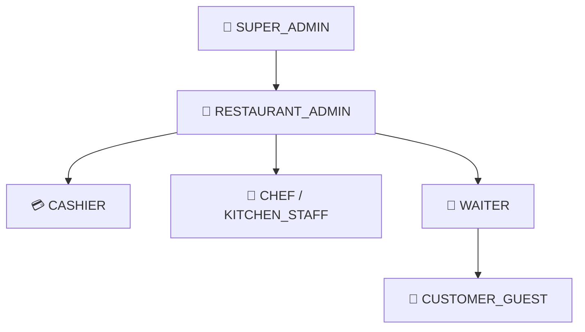
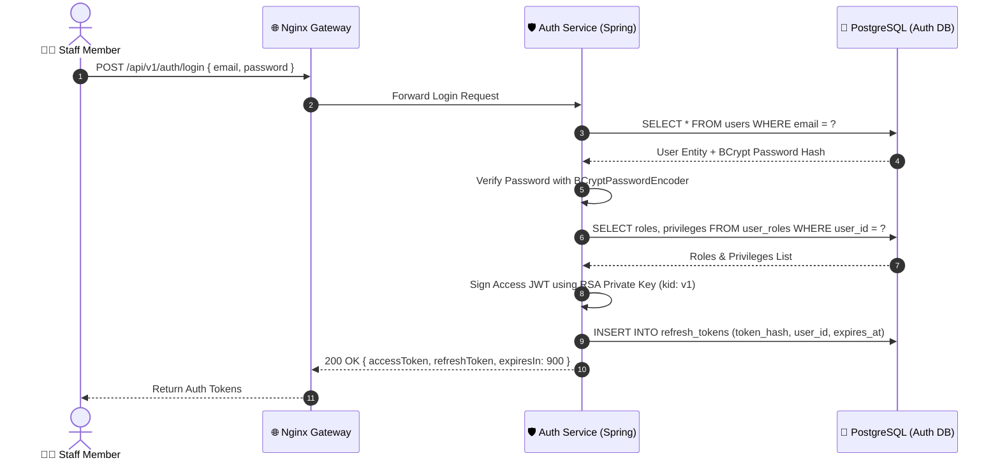
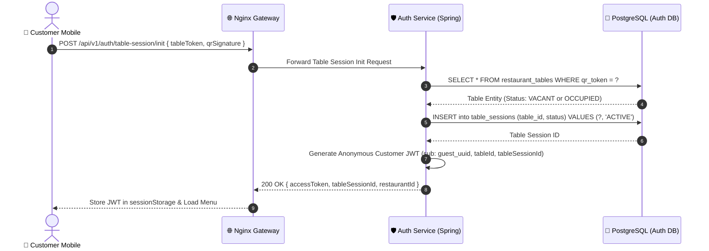
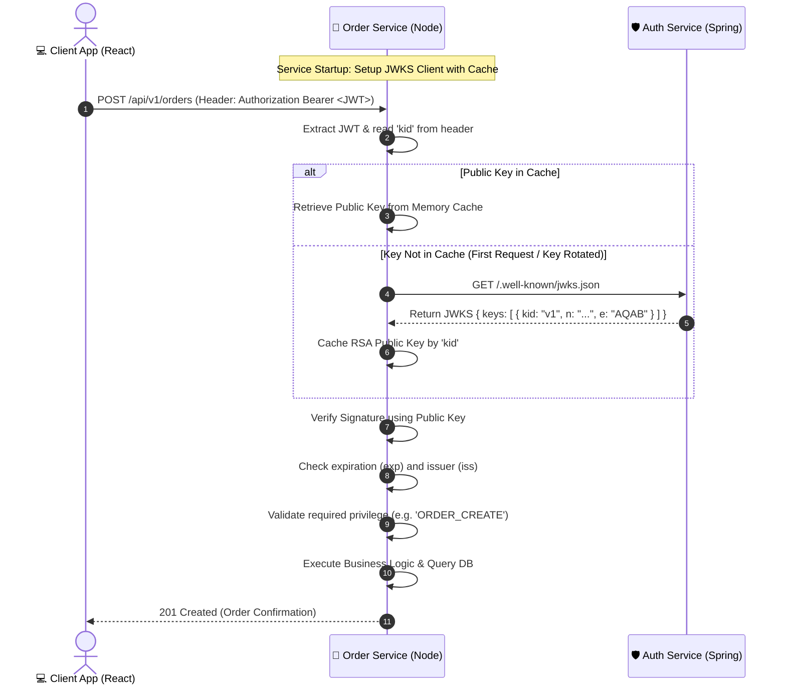
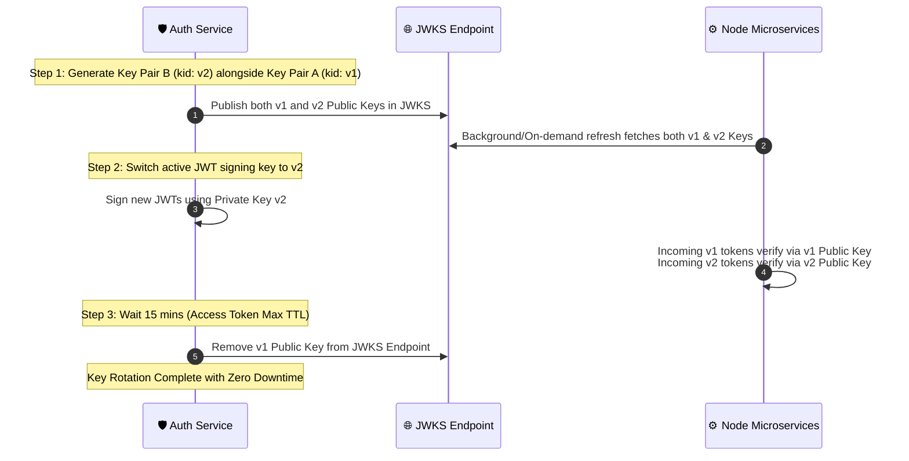

# 🍽️ DineFlow Authentication & Authorization Specification

> **Document Version**: 2.0.0  
> **Status**: Approved Architecture & Specification  
> **Target Ecosystem**: Smart Contactless Dining Platform (SCDP / DineFlow)  
> **Authentication Standard**: Centralized Spring Boot Auth + JWT (RS256)  
> **Authorization Model**: Granular Role-Based Access Control (RBAC) + Multi-Tenant Isolation  
> **Public Key Distribution**: JWKS (`GET /.well-known/jwks.json`)  
> **Last Updated**: July 2026  

---

## 1. 📌 Executive Summary & Core Principles

The **DineFlow Authentication & Authorization System** is built on a **decoupled, stateless microservice security model**. 

Centralized credential verification, password hashing, and token issuance occur **exclusively** inside the **Authentication Service** (`./auth`, Java 17 / Spring Boot 3.x). Downstream microservices (`./menu-service`, `./order-service`, `./payment-service`, `./notification-service`) independently verify incoming request JWT signatures locally using **RS256 Asymmetric Cryptography** and a **JSON Web Key Set (JWKS)** endpoint.

```
                           Client Applications
                 (Customer PWA / Kitchen KDS / Admin Portal)
                                     │
                                     │ HTTP / WSS Requests
                                     ▼
                        ┌──────────────────────────┐
                        │    Nginx API Gateway     │
                        │        (Port 80)         │
                        └────────────┬─────────────┘
                                     │
         ┌───────────────────────────┼───────────────────────────┐
         │ /api/v1/auth/             │ /api/v1/menu/             │ /api/v1/orders/
         ▼                           ▼                           ▼
┌──────────────────┐       ┌──────────────────┐        ┌──────────────────┐
│  Auth Service    │       │   Menu Service   │        │  Order Service   │
│ (Spring Boot)    │       │  (Node / Express)│        │ (Node / Express) │
│ Port 8081        │       │  Port 3001       │        │ Port 3002        │
└────────┬─────────┘       └────────┬─────────┘        └────────┬─────────┘
         │                          │                           │
   Issues JWTs (RS256)      Verifies via JWKS           Verifies via JWKS
   Exposes JWKS             Local Authorization         Local Authorization
```

### Core Security Pillars
1. **Centralized Authentication**: Only the Spring Boot Auth Service checks credentials, handles password hashes, issues JWTs, and manages refresh tokens.
2. **Decoupled Verification**: Downstream microservices never call the Auth Service over the network during request execution. JWTs are verified locally using public keys.
3. **Asymmetric RS256 Signing**: The private RSA key remains strictly inside the Auth Service. Node.js microservices receive only public keys via JWKS.
4. **Dual Identity Support**: Full support for both **Staff Accounts** (Users with persistent roles) and **Customer Table Sessions** (Anonymous QR-code sessions tied to table IDs).
5. **Multi-Tenant Data Isolation**: Every JWT embeds a `restaurantId` claim enforcing tenant-level database query boundaries.

---

## 2. 🛠️ Microservice System Matrix & Port Architecture

| Service Name | Technology | Container Name | Internal Port | Gateway Path Prefix | Primary Storage | Auth Role |
| :--- | :--- | :--- | :--- | :--- | :--- | :--- |
| **API Gateway** | Nginx | `scdp-gateway` | `80` | `/` | — | Reverse Proxy & SSL Termination |
| **Auth Service** | Spring Boot 3.x | `scdp-auth-svc` | `8081` | `/api/v1/auth/` | PostgreSQL (`scdp_db`) | Centralized JWT Issuance & JWKS |
| **Menu Service** | Node.js / Express | `scdp-menu-svc` | `3001` | `/api/v1/menu/` | MongoDB (`scdp_menu`) + Redis | Local JWKS Verification & RBAC |
| **Order Service** | Node.js / Express | `scdp-order-svc` | `3002` | `/api/v1/orders/` | PostgreSQL (`scdp_db`) + Redis | Local JWKS Verification & RBAC |
| **Payment Service** | Node.js / Express | `scdp-payment-svc` | `3003` | `/api/v1/payments/` | PostgreSQL (`scdp_db`) | Local JWKS Verification & RBAC |
| **Notification Svc**| Node.js + WS | `scdp-notif-svc` | `3004` | `/ws/` | Redis (Pub/Sub) | WebSocket Connection Auth |

---

## 3. 👥 User Roles & Privilege Matrix (RBAC)

DineFlow uses a fine-grained **Role-Based Access Control (RBAC)** architecture combining high-level roles with explicit privileges.

### 3.1 Role Hierarchy



### 3.2 Granular Privilege Mapping

| Privilege Name | Description | Target Service | Permitted Roles |
| :--- | :--- | :--- | :--- |
| `MENU_READ` | View menu items, categories, & modifiers | `menu-service` | `ALL` |
| `MENU_CREATE` | Add new menu items & categories | `menu-service` | `RESTAURANT_ADMIN`, `SUPER_ADMIN` |
| `MENU_UPDATE` | Edit existing menu items & prices | `menu-service` | `RESTAURANT_ADMIN`, `SUPER_ADMIN` |
| `MENU_TOGGLE_AVAIL` | Toggle item out-of-stock availability | `menu-service` | `RESTAURANT_ADMIN`, `CHEF` |
| `ORDER_CREATE` | Submit new food orders | `order-service` | `CUSTOMER_GUEST`, `WAITER`, `RESTAURANT_ADMIN` |
| `ORDER_READ_ACTIVE` | View kitchen queue & active orders | `order-service` | `CHEF`, `WAITER`, `CASHIER`, `RESTAURANT_ADMIN` |
| `ORDER_UPDATE_STATUS` | Advance order state (`PREPARING` ➔ `READY`) | `order-service` | `CHEF`, `WAITER` |
| `ORDER_CANCEL` | Cancel submitted or pending orders | `order-service` | `RESTAURANT_ADMIN`, `CASHIER` |
| `PAYMENT_PROCESS` | Initiate payment gateway checkout | `payment-service` | `CUSTOMER_GUEST`, `CASHIER`, `RESTAURANT_ADMIN` |
| `PAYMENT_REFUND` | Trigger transaction refund | `payment-service` | `RESTAURANT_ADMIN`, `SUPER_ADMIN` |
| `TABLE_MANAGE` | Generate table QR codes & set table status | `auth-service` | `RESTAURANT_ADMIN` |
| `STAFF_MANAGE` | Create, update, or deactivate staff accounts | `auth-service` | `RESTAURANT_ADMIN`, `SUPER_ADMIN` |

---

## 4. 🔑 Key Management & RS256 vs HS256 Strategy

### Why RS256 Asymmetric Cryptography?

> [!IMPORTANT]
> HS256 requires sharing a secret key across all microservices. If any single Node.js microservice is compromised, an attacker gains the capability to forge valid administrative JWTs for the entire platform.

```text
HS256 (Symmetric - Vulnerable)          RS256 (Asymmetric - Enterprise Secure)
───────────────────────────────          ───────────────────────────────────────
Auth Service ──[Shared Secret]──► Menu Svc   Auth Service [Private Key - Hidden]
                     ▲                       │ Signs JWTs
                     │                       ▼
               Order Service             Node Services [Public Key Only]
               (Compromise =             (Can ONLY verify signatures,
                Token Forgery)            CANNOT forge tokens)
```

### Key Lifecycle & Storage
- **Private Key (`private.pem`)**: 2048-bit or 4096-bit RSA Private Key. Exists **ONLY** in `auth-service`. Never exported, logged, or exposed.
- **Public Key (`public.pem`)**: Corresponding RSA Public Key. Exposed publicly via JWKS endpoint for microservices to download and cache.
- **Key Rotation ID (`kid`)**: Key ID header identifier (e.g., `kid: "dineflow-key-2026-v1"`).

---

## 5. 📑 JWT Structure & Payload Specifications

### 5.1 JOSE Header
```json
{
  "alg": "RS256",
  "typ": "JWT",
  "kid": "dineflow-key-2026-v1"
}
```

### 5.2 Staff User Access Token Payload (15-Minute TTL)
```json
{
  "iss": "https://dineflow.com/api/v1/auth",
  "sub": "u_9b1deb4d-3b7d-4bad-9bdd-2b0d7b3dcb6d",
  "email": "manager@bistro.com",
  "restaurantId": "rest_01h87z9k4m",
  "type": "STAFF",
  "roles": [
    "RESTAURANT_ADMIN"
  ],
  "privileges": [
    "MENU_READ", "MENU_CREATE", "MENU_UPDATE", "MENU_TOGGLE_AVAIL",
    "ORDER_CREATE", "ORDER_READ_ACTIVE", "ORDER_UPDATE_STATUS", "ORDER_CANCEL",
    "PAYMENT_PROCESS", "TABLE_MANAGE", "STAFF_MANAGE"
  ],
  "iat": 1785500000,
  "exp": 1785500900
}
```

### 5.3 Customer QR Table Session Access Token Payload (2-Hour Active TTL)
```json
{
  "iss": "https://dineflow.com/api/v1/auth",
  "sub": "guest_c7a10f88-4e12-4211-9a73",
  "restaurantId": "rest_01h87z9k4m",
  "tableId": "tbl_12_outdoor",
  "tableNumber": 12,
  "tableSessionId": "sess_e9f8a7b6c5",
  "type": "CUSTOMER",
  "roles": [
    "CUSTOMER_GUEST"
  ],
  "privileges": [
    "MENU_READ",
    "ORDER_CREATE",
    "PAYMENT_PROCESS"
  ],
  "iat": 1785500000,
  "exp": 1785507200
}
```

---

## 6. 🔄 Authentication & Authorization Sequence Flows

### 6.1 Staff User Login & Token Issuance Flow



---

### 6.2 Customer QR Code Table Session Handshake



---

### 6.3 Microservice Decoupled Verification via JWKS



---

### 6.4 Zero-Downtime Key Rotation Strategy



---

## 7. 🌐 JSON Web Key Set (JWKS) Specification

### Endpoint Locations
- `GET /.well-known/jwks.json`
- `GET /api/v1/auth/.well-known/jwks.json`

### Example JWKS Response Structure
```json
{
  "keys": [
    {
      "kty": "RSA",
      "use": "sig",
      "alg": "RS256",
      "kid": "dineflow-key-2026-v1",
      "n": "u18Z...[RSA Modulus Base64URL]...",
      "e": "AQAB"
    }
  ]
}
```

---

## 8. 💻 Code Blueprints & Reference Implementations

### 8.1 Spring Boot 3.x — JWKS Endpoint Controller

```java
package com.dineflow.auth.controller;

import com.nimbusds.jose.jwk.JWKSet;
import com.nimbusds.jose.jwk.RSAKey;
import org.springframework.web.bind.annotation.GetMapping;
import org.springframework.web.bind.annotation.RestController;

import java.util.Map;

@RestController
public class JwksController {

    private final RSAKey rsaPublicKey;

    public JwksController(RSAKey rsaPublicKey) {
        this.rsaPublicKey = rsaPublicKey;
    }

    @GetMapping("/.well-known/jwks.json")
    public Map<String, Object> getJwks() {
        JWKSet jwkSet = new JWKSet(this.rsaPublicKey.toPublicJWK());
        return jwkSet.toJSONObject();
    }
}
```

---

### 8.2 Spring Boot 3.x — Security Filter Chain

```java
package com.dineflow.auth.config;

import org.springframework.context.annotation.Bean;
import org.springframework.context.annotation.Configuration;
import org.springframework.security.config.annotation.web.builders.HttpSecurity;
import org.springframework.security.config.annotation.web.configuration.EnableWebSecurity;
import org.springframework.security.config.http.SessionCreationPolicy;
import org.springframework.security.crypto.bcrypt.BCryptPasswordEncoder;
import org.springframework.security.crypto.password.PasswordEncoder;
import org.springframework.security.web.SecurityFilterChain;

@Configuration
@EnableWebSecurity
public class SecurityConfig {

    @Bean
    public SecurityFilterChain filterChain(HttpSecurity http) throws Exception {
        http
            .csrf(csrf -> csrf.disable())
            .cors(cors -> cors.configure(http))
            .sessionManagement(session -> session.sessionCreationPolicy(SessionCreationPolicy.STATELESS))
            .authorizeHttpRequests(auth -> auth
                .requestMatchers(
                    "/api/v1/auth/login",
                    "/api/v1/auth/register",
                    "/api/v1/auth/table-session/init",
                    "/api/v1/auth/refresh",
                    "/.well-known/jwks.json",
                    "/api/v1/auth/.well-known/jwks.json"
                ).permitAll()
                .anyRequest().authenticated()
            );

        return http.build();
    }

    @Bean
    public PasswordEncoder passwordEncoder() {
        return new BCryptPasswordEncoder(12);
    }
}
```

---

### 8.3 Node.js / Express — Decoupled JWKS JWT Verification Middleware

```javascript
// middleware/jwtVerifier.js
const jwt = require('jsonwebtoken');
const jwksClient = require('jwks-rsa');

const JWKS_URI = process.env.JWKS_URI || 'http://auth-service:8081/.well-known/jwks.json';

const client = jwksClient({
  jwksUri: JWKS_URI,
  cache: true,
  cacheMaxEntries: 5,
  cacheMaxAge: 600000, // 10 minutes cache
  rateLimit: true,
  jwksRequestsPerMinute: 10
});

function getKey(header, callback) {
  client.getSigningKey(header.kid, (err, key) => {
    if (err) return callback(err, null);
    const signingKey = key.getPublicKey();
    callback(null, signingKey);
  });
}

const verifyJwt = (req, res, next) => {
  const authHeader = req.headers.authorization;
  if (!authHeader || !authHeader.startsWith('Bearer ')) {
    return res.status(401).json({ error: 'UNAUTHORIZED', message: 'Missing or malformed Authorization token' });
  }

  const token = authHeader.split(' ')[1];

  jwt.verify(token, getKey, { algorithms: ['RS256'] }, (err, decoded) => {
    if (err) {
      return res.status(401).json({ error: 'INVALID_TOKEN', message: err.message });
    }

    // Attach decoded identity to request object
    req.user = decoded;
    next();
  });
};

const requirePrivilege = (privilege) => {
  return (req, res, next) => {
    if (!req.user || !Array.isArray(req.user.privileges)) {
      return res.status(403).json({ error: 'FORBIDDEN', message: 'User identity has no privileges' });
    }

    if (!req.user.privileges.includes(privilege)) {
      return res.status(403).json({ error: 'FORBIDDEN', message: `Missing required privilege: ${privilege}` });
    }

    next();
  };
};

module.exports = { verifyJwt, requirePrivilege };
```

---

## 9. 🗄️ Relational Database Schema (PostgreSQL Security Entities)

```sql
-- PostgreSQL Security & Refresh Token Schema

CREATE TABLE roles (
    id SERIAL PRIMARY KEY,
    name VARCHAR(50) UNIQUE NOT NULL -- 'SUPER_ADMIN', 'RESTAURANT_ADMIN', 'CHEF', 'WAITER', 'CASHIER', 'CUSTOMER_GUEST'
);

CREATE TABLE privileges (
    id SERIAL PRIMARY KEY,
    name VARCHAR(100) UNIQUE NOT NULL -- 'MENU_READ', 'ORDER_CREATE', etc.
);

CREATE TABLE role_privileges (
    role_id INT REFERENCES roles(id) ON DELETE CASCADE,
    privilege_id INT REFERENCES privileges(id) ON DELETE CASCADE,
    PRIMARY KEY (role_id, privilege_id)
);

CREATE TABLE users (
    id UUID PRIMARY KEY DEFAULT gen_random_uuid(),
    restaurant_id VARCHAR(50) NOT NULL,
    email VARCHAR(150) UNIQUE NOT NULL,
    password_hash VARCHAR(255) NOT NULL,
    full_name VARCHAR(100) NOT NULL,
    role_id INT REFERENCES roles(id),
    is_active BOOLEAN DEFAULT TRUE,
    created_at TIMESTAMP DEFAULT CURRENT_TIMESTAMP
);

CREATE TABLE refresh_tokens (
    id UUID PRIMARY KEY DEFAULT gen_random_uuid(),
    user_id UUID REFERENCES users(id) ON DELETE CASCADE,
    token_hash VARCHAR(255) UNIQUE NOT NULL,
    expires_at TIMESTAMP NOT NULL,
    is_revoked BOOLEAN DEFAULT FALSE,
    created_at TIMESTAMP DEFAULT CURRENT_TIMESTAMP
);

CREATE TABLE table_sessions (
    id UUID PRIMARY KEY DEFAULT gen_random_uuid(),
    table_id UUID NOT NULL,
    restaurant_id VARCHAR(50) NOT NULL,
    guest_uuid UUID NOT NULL,
    status VARCHAR(20) DEFAULT 'ACTIVE', -- 'ACTIVE', 'CLOSED'
    created_at TIMESTAMP DEFAULT CURRENT_TIMESTAMP,
    expires_at TIMESTAMP NOT NULL
);
```

---

## 10. 🔒 Multi-Tenant Data Security & Query Isolation

> [!SECURITY]
> Cross-Tenant Protection: Every microservice database query MUST mandate `restaurant_id` filtering derived directly from the verified JWT payload (`req.user.restaurantId`).

### Relational SQL Isolation Example (Order Service)
```sql
-- Security Enforced SQL Pattern
SELECT * FROM orders 
WHERE id = $1 AND restaurant_id = $2;
```

### Document Storage Isolation Example (Menu Service - MongoDB)
```javascript
// Security Enforced MongoDB Query Pattern
const menuItem = await MenuItem.findOne({
  _id: req.params.id,
  restaurantId: req.user.restaurantId // Injected strictly from JWT
});
```

---

## 11. 🛡️ Security Best Practices Checklist & SLAs

| Security Safeguard | Implementation Status | SLA / Standard |
| :--- | :--- | :--- |
| **Asymmetric RS256** | ✅ Active | Private key contained exclusively in `auth-service` |
| **Short-Lived Access Tokens** | ✅ Active | 15 minutes TTL for Staff, 2 hours TTL for Table Sessions |
| **Refresh Token Rotation** | ✅ Active | One-time-use refresh tokens with server-side revocation DB |
| **JWKS Caching** | ✅ Active | Microservices cache JWKS for 10 minutes with auto-retry |
| **BCrypt Password Hashing** | ✅ Active | BCrypt strength factor 12 |
| **Transport Layer Security** | ✅ Active | TLS 1.3 for all HTTP/WSS traffic via Nginx Gateway |
| **Tenant Isolation** | ✅ Active | Mandatory `restaurantId` filter on 100% of data queries |
| **WebSocket Connection Auth** | ✅ Active | Initial WSS handshake validates JWT token parameter |