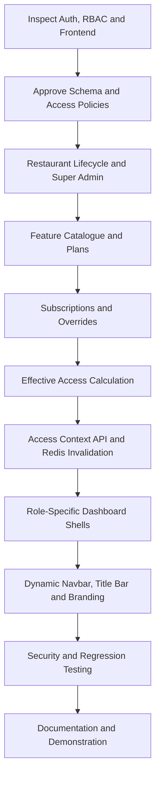

# DineFlow — Subscription-Aware Role Dashboards & Restaurant Feature Access Timeline

> Version: 1.0 | Proposed schedule for review | Prepared: 02 November 2026  
> Related specification: `subscription-role-dashboard.spec.md`

## 1. Estimate and milestones

**Planning estimate: 6 weeks** for a focused single-developer implementation, assuming the existing application can be run locally and the first release excludes automated recurring billing. This is an estimate, not a committed delivery date. Re-estimate after repository inspection.

| Week | Milestone | Outcome |
|---|---|---|
| 1 | Architecture and schema review | Approved data model, role/dashboard matrix and policy decisions |
| 2 | Restaurant lifecycle / Super Admin | Approval, rejection, unique Restaurant ID, activate/suspend |
| 3 | Plans and subscriptions | Feature catalogue, plans, subscriptions and overrides |
| 4 | Effective authorization | Access-context API, backend checks, Redis invalidation and tenant tests |
| 5 | Role-specific UI | Separate shells, dynamic navigation/title bars and branding |
| 6 | Integration and handover | Security/regression tests, docs and demonstration |

## 2. Detailed plan

### Week 1 — Architecture and schema review
- [ ] Inspect current React routes, shared dashboard layout and authentication state.
- [ ] Inspect Spring Boot Auth Service entities, repositories, controllers and JWT claims.
- [ ] Inspect existing `roles`, `privileges`, `role_privileges`, `users` and refresh-token schema.
- [ ] Verify restaurant registration and Restaurant ID generation.
- [ ] Verify Nginx routing, service ownership and Redis event conventions.
- [ ] Map `SUPER_ADMIN`, `RESTAURANT_ADMIN`, `WAITER`, `CHEF`/`KITCHEN_STAFF`, `CASHIER` to dashboard shells.
- [ ] Decide single-restaurant versus multi-membership accounts.
- [ ] Decide how Super Admin is represented given `users.restaurant_id NOT NULL`.
- [ ] Approve subscription-state policy, override precedence and revocation target.

**Deliverables:** architecture decision record, migration proposal, role/dashboard matrix, feature catalogue draft and API contract.

**Exit:** no parallel RBAC schema; customer table-session flow explicitly protected; schema decisions approved.

### Week 2 — Super Admin and restaurant lifecycle
- [ ] Add/extend restaurant registration and status persistence.
- [ ] Implement server-side unique, immutable Restaurant ID generation if not already present.
- [ ] Implement Super Admin restaurant list/detail, approve/reject, activate/suspend endpoints.
- [ ] Enforce platform-level privileges.
- [ ] Audit actor, action, target, timestamp and result.
- [ ] Build initial Super Admin shell and show DineFlow branding.

**Deliverables:** restaurant lifecycle APIs, Super Admin restaurant screen, ID approval flow and audit events.

**Exit:** non-Super Admin cannot approve/reject/suspend; IDs are server-generated; backend enforces status.

### Week 3 — Feature catalogue, plans and subscriptions
- [ ] Create feature catalogue and seed approved keys.
- [ ] Create plan CRUD and plan-feature mapping, including approved limits.
- [ ] Create restaurant subscription persistence and lifecycle transitions.
- [ ] Implement assignment, renewal, cancellation, suspension and expiry policy.
- [ ] Implement restaurant-specific overrides with reason and effective dates.
- [ ] Validate transition/date rules server-side.
- [ ] Build Super Admin plan/subscription screens.
- [ ] Audit plan, subscription and override changes.

**Deliverables:** catalogue, configurable Starter/Professional/Enterprise/Custom plans, subscription management and override API/UI.

**Exit:** plan and overrides resolve deterministically; invalid transitions rejected; history retained.

### Week 4 — Effective authorization and access context
- [ ] Implement effective-access calculation in the appropriate authorization domain service.
- [ ] Reuse existing roles/privileges; do not duplicate RBAC.
- [ ] Enforce restaurant status + subscription + feature + role privilege.
- [ ] Implement `GET /api/v1/access/context` and feature/navigation endpoints.
- [ ] Resolve restaurant name from verified identity/membership.
- [ ] Return DineFlow platform branding for Super Admin.
- [ ] Decide JWT claim strategy; avoid stale long-lived entitlement claims.
- [ ] Implement access versioning and Redis invalidation.
- [ ] Add backend guards to protected routes/services.
- [ ] Test missing privilege, disabled feature, expired subscription, suspended restaurant and cross-tenant access.
- [ ] Verify customer table-session tokens remain unchanged in purpose and scope.

**Deliverables:** effective-access service, access-context API, cache invalidation and backend authorization tests.

**Exit:** hidden UI is not the only protection; tenant isolation passes; revocation meets approved target; QR session still works.

### Week 5 — Role-specific dashboards
- [ ] Create reusable design-system components for header, sidebar, title bar, breadcrumbs and profile controls.
- [ ] Create separate shells/routes for Super Admin, Restaurant Admin, Waiter, Kitchen and Cashier.
- [ ] Keep customer PWA/table-session routes separate.
- [ ] Load dashboard config from authenticated access context.
- [ ] Render navbar entries only when feature and privilege checks pass.
- [ ] Render title and actions from active route and effective permissions.
- [ ] Show DineFlow to Super Admin.
- [ ] Show authorized restaurant name to restaurant-oriented staff.
- [ ] Add frontend route guards for UX; backend remains security boundary.
- [ ] Refresh access context after login and access changes.
- [ ] Add loading, forbidden, empty and expired-subscription states.

**Deliverables:** role-specific shells, dynamic navigation/title bars, tenant-aware branding and route handling.

**Exit:** each role lands on its own dashboard; no unauthorized navigation is shown; direct route/API access is still denied server-side when unauthorized.

### Week 6 — Integration, regression and handover
- [ ] Unit-test plans, subscriptions, overrides and permission calculation.
- [ ] Integration-test Super Admin and restaurant APIs.
- [ ] Test dashboards role by role.
- [ ] Test cross-tenant access with multiple restaurants.
- [ ] Test live-session revocation and Redis invalidation/cache misses.
- [ ] Test trialing, active, past-due, cancelled, expired and suspended states.
- [ ] Regression-test QR table-session initialization.
- [ ] Regression-test menu, cart, order submission and payment.
- [ ] Regression-test kitchen updates and waiter alerts.
- [ ] Review audit logs and denied-access handling.
- [ ] Update API/architecture documentation and prepare project-guide demo.

**Deliverables:** test report, updated documentation, end-to-end demo and known-limitations list.

**Exit:** critical authorization/tenant tests pass; existing QR/order/payment/kitchen flows pass; branding and navigation are correct; no unresolved critical security issue.

## 3. Dependency flow

## 4. Test matrix

| Scenario | Expected result |
|---|---|
| Super Admin login | Super Admin dashboard; header says DineFlow |
| Restaurant Admin login | Restaurant Admin dashboard; authorized restaurant name |
| Waiter login | Waiter dashboard; permitted modules; restaurant name |
| Kitchen login | Kitchen/KDS dashboard; permitted modules; restaurant name |
| Cashier login | Cashier dashboard; permitted modules; restaurant name |
| Feature on, role privilege absent | Action remains unavailable |
| Role privilege present, feature off | Action remains unavailable |
| Subscription expires | Subscription-dependent features restricted; data retained |
| Restaurant suspended | Restaurant operations denied according to policy |
| Super Admin changes entitlement | Cache invalidated and subsequent protected requests use new access |
| Restaurant A requests Restaurant B resource | Rejected; no cross-tenant data returned |
| Customer scans table QR | Existing table-session flow works |
| Customer places order | Existing ordering flow works |
| MCP tool attempts forbidden action | Same authorization applies; denial is audited |

## 5. Risks and mitigations

| Risk | Mitigation |
|---|---|
| JWT privilege claims stale after revocation | Versioned access checks, bounded cache TTL and Redis invalidation |
| User schema assumes one restaurant | Decide platform-user/membership model before migration |
| Duplicate RBAC schema | Extend existing roles/privileges tables |
| Frontend-only authorization | Enforce on every protected backend operation |
| Expiry interrupts active customer flow | Define lifecycle policy and regression-test QR/order paths |
| Redis event missed | Bounded TTL plus authoritative version/recomputation |
| UI duplication | Shared components with distinct role shells/configurations |
| MCP bypass | Same service-layer authorization as REST |

## 6. First-release scope

**Include:** restaurant approval/IDs, feature catalogue, plans, subscriptions, overrides, existing RBAC integration, role-specific dashboards, dynamic navbar/title bars, branding, backend tenant/feature enforcement, audit and Redis invalidation.

**Defer unless approved:** automated recurring payments, advanced billing/invoicing, multi-restaurant user switching, advanced usage metering, and full implementation of the AI Restaurant Agent, Personal Dining Agent, Knowledge Graph, Skill-Aware Kitchen and Simulation Engine.

## 7. Definition of done

1. Super Admin can approve restaurants, manage plans, subscriptions and entitlements.
2. Restaurant staff access is constrained by subscription and existing role privileges.
3. Each supported role has its own dashboard shell and landing page.
4. Navigation/title bars reflect effective access.
5. Super Admin sees DineFlow; restaurant users see their authorized restaurant name.
6. Backend authorization and tenant isolation are verified.
7. Changes invalidate stale access.
8. Existing QR, ordering, payment and kitchen workflows pass regression tests.
9. Documentation and project-guide demonstration are ready.
